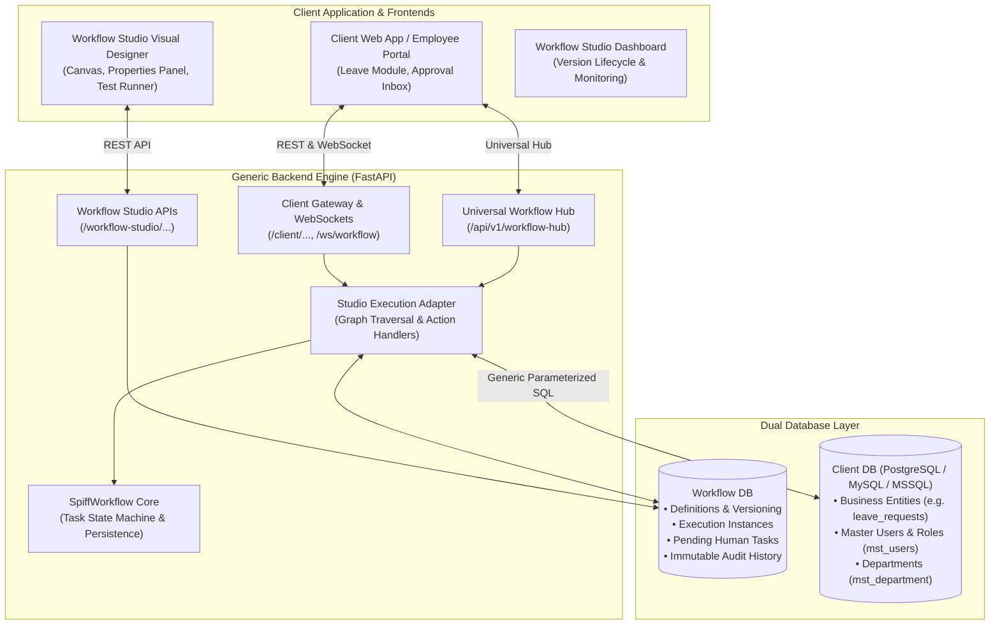

# ⚡ Enterprise Workflow Platform & Studio

An enterprise-grade, **100% UI + Database-Driven Workflow Orchestration Platform** featuring a **Generic Python FastAPI / SpiffWorkflow Engine**, an interactive **React 19 / @xyflow Visual Designer**, and a **Real-Time Client Application Gateway**.

The platform enables organizations to visually design, validate, publish, execute, and monitor complex business workflows (such as Multi-Tier Risk Approvals, Leave Management, Purchase Orders, and 3rd-Party API integrations) **without writing or modifying any backend Python code**.

---

## 📚 Complete Technical Documentation

A comprehensive, developer-oriented documentation suite is available in the [`docs/`](./docs/README.md) directory:

- 📖 **[Documentation Home & Index](./docs/README.md)**
- 🏛️ **[Architecture & Overview](./docs/01-overview/)**: [Project Overview](./docs/01-overview/project-overview.md) | [System Architecture](./docs/01-overview/system-architecture.md) | [Technology Stack](./docs/01-overview/technology-stack.md)
- ⚙️ **[Backend Platform](./docs/02-backend/)**: [Backend Architecture](./docs/02-backend/backend-architecture.md) | [Complete API Reference](./docs/02-backend/api-reference.md) | [Authentication & Security](./docs/02-backend/authentication-security.md) | [Error Handling & Logging](./docs/02-backend/error-handling-logging.md)
- 🔄 **[Workflow Engine](./docs/03-workflow-engine/)**: [Engine Architecture](./docs/03-workflow-engine/engine-architecture.md) | [Workflow Lifecycle](./docs/03-workflow-engine/workflow-lifecycle.md) | [BPMN Compiler](./docs/03-workflow-engine/bpmn-compiler.md) | [Runtime Execution](./docs/03-workflow-engine/runtime-execution.md) | [Activities & Nodes](./docs/03-workflow-engine/activities-and-nodes.md) | [Human Tasks](./docs/03-workflow-engine/human-tasks-and-approvals.md) | [Versioning](./docs/03-workflow-engine/workflow-versioning.md)
- 🎨 **[Frontend Studio](./docs/04-frontend/)**: [Frontend Architecture](./docs/04-frontend/frontend-architecture.md) | [Workflow Designer](./docs/04-frontend/workflow-designer.md) | [Node Configuration](./docs/04-frontend/node-configuration.md) | [Monitoring UI](./docs/04-frontend/execution-and-monitoring-ui.md) | [API Integration](./docs/04-frontend/frontend-api-integration.md)
- 🗄️ **[Database Architecture](./docs/05-database/)**: [Dual-Database Architecture](./docs/05-database/database-architecture.md) | [Workflow Schema](./docs/05-database/workflow-schema.md) | [Client DB Integration](./docs/05-database/client-database-integration.md) | [Persistence & Transactions](./docs/05-database/persistence-and-transactions.md)
- 🔌 **[Integrations](./docs/06-integrations/)**: [Client Gateway](./docs/06-integrations/client-application-gateway.md) | [REST API Nodes](./docs/06-integrations/rest-api-nodes.md) | [Email Services](./docs/06-integrations/email-and-notifications.md) | [WebSocket Events](./docs/06-integrations/websocket-events.md)
- 🚀 **[Operations & Deployment](./docs/07-operations/)**: [Local Setup Guide](./docs/07-operations/local-development-setup.md) | [Docker Deployment](./docs/07-operations/docker-deployment.md) | [CI/CD Pipelines](./docs/07-operations/ci-cd-pipeline.md) | [Monitoring & Alerting](./docs/07-operations/monitoring-and-alerting.md) | [Troubleshooting](./docs/07-operations/troubleshooting.md)
- 🛡️ **[Quality & Governance](./docs/08-quality-and-maintenance/)**: [Testing Strategy](./docs/08-quality-and-maintenance/testing-strategy.md) | [Security Review](./docs/08-quality-and-maintenance/security-review.md) | [Contribution Guide](./docs/08-quality-and-maintenance/contribution-guide.md)
- 📊 **[System Diagrams](./docs/diagrams/)**: [System Context](./docs/diagrams/system-context.md) | [Execution Sequence](./docs/diagrams/workflow-execution-sequence.md) | [Deployment Architecture](./docs/diagrams/deployment-architecture.md)

---

## 🌟 Core Architectural Principles

1. **100% UI + Client Database Driven**: Workflow routing, decision branches, human task assignments, email templates, and database operations are fully configured via the UI and stored as versioned graphs.
2. **Zero Domain-Specific Hardcoding**: The Python backend serves strictly as a generic graph traversal engine. No hardcoded tables, column names, status codes, or business logic exist in backend code.
3. **Dual Database Architecture**:
   - **Client Database (PostgreSQL / MySQL / MSSQL / SQLite / Oracle)**: The single source of truth for organization business data.
   - **Workflow Database (PostgreSQL / SQLite)**: Stores workflow specifications, versions, node configurations, active instances, task state machines, execution logs, and audit trails.
4. **Automated Database CRUD & Schema Discovery**: Generic `CREATE_RECORD` (`INSERT`), `READ_RECORD` (`SELECT`), `UPDATE_RECORD` (`UPDATE`), and `DELETE_RECORD` (`DELETE`) execution nodes automatically introspect client database schemas and execute parameterized SQL safely with primary key resolution and conflict handling.
5. **REST API & Webhook Integration**: Built-in `API_CALL` node orchestrates external services (HTTP `GET`, `POST`, `PUT`, `PATCH`, `DELETE`) with dynamic template body interpolation and response variable capture.
6. **Real-Time Client Application Gateway**: WebSocket (`/ws/workflow`) and REST endpoints (`/client/*`, `/api/v1/workflow-hub`) for external client applications to trigger workflows, fetch pending tasks, submit decisions, and receive instant updates.
7. **Complete Audit Trail**: Immutable logging of every state transition, actor, decision outcome, and execution timestamp in `workflow_history`.

---

## 🏗️ System Architecture



---

## 🎨 Supported Visual Node Types

| Node Type | Category | Key Features & Capabilities |
| :--- | :--- | :--- |
| **`START`** | Trigger / Boundary | Workflow entry point triggered via Client Gateway (`/client/submit`), Universal Hub, or manual submission. |
| **`USER_TASK`** | Human Interaction | Human review gate assigned dynamically to a **Role**, **User**, or **Department** loaded from live metadata. |
| **`APPROVAL`** | Human Interaction | Approval gate with decision outcomes (`APPROVE`, `REJECT`, `REQUEST_CHANGES`) and audit logging. |
| **`CREATE_RECORD`** | Database Action | Automated insert (`INSERT INTO ...`) with type-aware presets (`NOW()`, `CURRENT_DATE`), and conflict rules (`DO NOTHING / DO UPDATE`). |
| **`UPDATE_RECORD`** | Database Action | Automated field modification (`UPDATE ... SET ... WHERE id = :entity_id`) targeting client DB records upon approvals. |
| **`READ_RECORD`** | Database Action | Dynamic query (`SELECT ... FROM ... WHERE ...`) retrieving entity fields into runtime memory for downstream conditions or emails. |
| **`DELETE_RECORD`** | Database Action | Parameterized record deletion with filter safeguards. |
| **`API_CALL`** | Integration | Outbound REST HTTP call (`GET`, `POST`, `PUT`, `PATCH`, `DELETE`) with dynamic headers and JSON variable interpolation. |
| **`CONDITION`** | Control-Flow | Dynamic rule evaluation supporting numeric (`>`), boolean (`== true`), and string comparisons without arbitrary code execution. |
| **`SWITCH`** | Control-Flow | Multi-way branching based on discrete field values (e.g. `HIGH`, `MEDIUM`, `LOW`). |
| **`COMMUNICATION`** | Notification | Dynamic email dispatcher using client DB SMTP credentials with interactive HTML preview and `{{variable}}` chips. |
| **`END`** | Boundary | Terminal state completing workflow execution (`COMPLETED`, `REJECTED`). |

---

## 🚀 Quick Start Guide

### Prerequisites
- **Python 3.11** (or 3.9+)
- **Node.js 22 LTS** (or 18+) & `npm`
- **PostgreSQL 15+** (or SQLite for local evaluation)

---

### 1. Local Automated Startup (Windows)

The platform includes automated launchers that verify dependencies, auto-detect network IPs, and start backend and frontend services:

- **HTTP Local Development**: Run `.\run_workflow_server.bat`
- **HTTPS / SSL Secure Development**: Run `.\run_workflow_server_ssl.bat`

---

### 2. Manual Cross-Platform Startup

#### Backend Setup & Startup
```bash
cd backend

# Create and activate virtual environment
python -m venv .venv
source .venv/bin/activate       # Linux/macOS
# .\.venv\Scripts\activate      # Windows

# Install dependencies
pip install -r requirements.txt

# Create .env from template and configure secrets
cp .env.example .env

# Start FastAPI Uvicorn server
uvicorn app.main:app --host 0.0.0.0 --port 8000 --reload
```

- **Backend API Base**: `http://localhost:8000`
- **Interactive Swagger Documentation**: `http://localhost:8000/docs`
- **Health Check Endpoint**: `http://localhost:8000/health`
- **Universal Hub Gateway**: `POST http://localhost:8000/api/v1/workflow-hub`

#### Frontend Setup & Startup
```bash
cd frontend

# Install frontend dependencies
npm install

# Start Vite development server
npm run dev -- --host 0.0.0.0 --port 5173
```

- **Workflow Studio Designer**: `http://localhost:5173`
- **Monitoring Dashboard**: `http://localhost:5173/?view=monitoring`

---

## 🧪 Testing & Validation

### Backend Pytest Suite
```bash
cd backend
python -m pytest tests/ -v --tb=short
```

### Frontend Linter & Build Validation
```bash
cd frontend
npm run lint    # Oxlint static code analysis
npm run build   # Production Vite bundle compilation
```

### Docker Compose Stack
```bash
# Production stack build and launch
docker compose up -d --build --remove-orphans

# Check container health status
docker compose ps
```

---

## ⚠️ Important Implementation Limitations

1. **Authentication Dev Fallback**: `get_current_user` in `backend/app/core/dependencies.py` currently falls back to a default mock admin user when no token is supplied, facilitating standalone local testing. For hardened public deployments, strict 401 rejection should be enabled.
2. **In-Flight Workflow Migration**: Instances running when a new workflow version is published will complete execution under their initial version graph; live state migration between versions is not currently supported.
3. **No Distributed 2-Phase Commit**: Distributed XA transactions across the workflow DB and client DB are not used. Failed client operations roll back immediately, and errors are recorded in the workflow activity history.

---

## 📄 License
This project is licensed under the **Enterprise Proprietary License**. All rights reserved.
