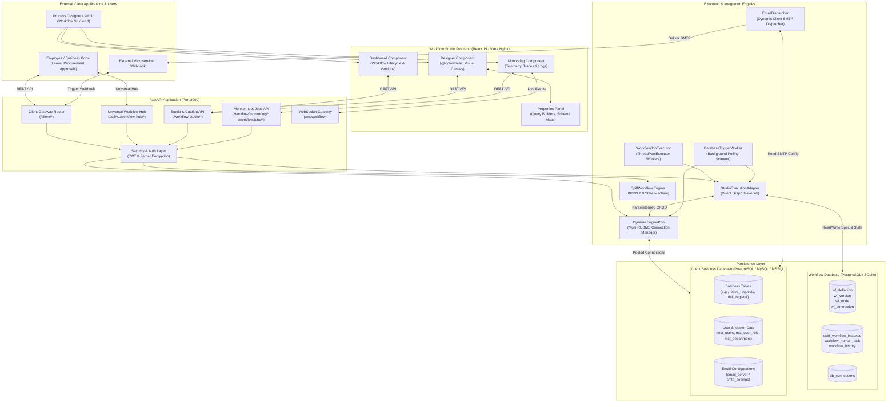

# System Architecture

## 1. Architectural Overview

WorkFlow-Automation uses a modular, decoupled architecture centered around three main tiers:
1. **Interactive Frontend Studio Tier**: A single-page application built with React 19, `@xyflow/react`, and Vite.
2. **Generic Backend Application Tier**: A high-performance Python FastAPI service providing workflow design APIs, execution runtimes, database introspection, and client integration gateways.
3. **Dual Persistence Tier**: A strict physical or logical separation between the internal **Workflow Engine Database** (specifications, versions, instances, audit logs) and the external **Client Business Database** (domain entities, user accounts, and master tables).

---

## 2. System Context & Component Architecture

---

## 3. Communication Patterns

### A. Frontend to Backend
- **REST APIs**: The React UI communicates with the FastAPI backend over standard HTTP/JSON requests. Base URLs and SSL modes are dynamically resolved via `frontend/vite.config.js` and `frontend/src/services/workflowStorage.js`.
- **WebSockets**: The frontend subscribes to `/ws/workflow` on load. The server broadcasts real-time execution transitions (`WORKFLOW_STARTED`, `TASK_READY`, `TASK_COMPLETED`, `WORKFLOW_COMPLETED`, and `JOB_*`), updating dashboard statistics and execution traces without polling.

### B. Client Gateway to Workflow Engine
- External systems submit data to either `/client/submit/{module_code}` or `/api/v1/workflow-hub`.
- The gateway extracts payload variables, maps the request to the active `published` workflow version for the given specification key, and either executes the process synchronously or enqueues it via `WorkflowJobExecutor`.

### C. Engine to Databases (Dual-Database Separation)
- **Workflow State**: The engine persists all definitions, active versions, node layouts, active instance states, and immutable audit logs into the workflow schema using the session factory defined in `backend/app/workflow/database.py`.
- **Business Data**: When a node performs a database action (`CREATE_RECORD`, `READ_RECORD`, `UPDATE_RECORD`, `DELETE_RECORD`), it does not touch the workflow database. Instead, it obtains an engine from `DynamicEnginePool`, which retrieves connection parameters from `db_connections`, decrypts the password using the application's `FERNET_KEY`, and executes strictly parameterized SQL against the client database.

---

## 4. Execution Engines: Dual Architecture

The repository contains two workflow execution approaches:
1. **`StudioExecutionAdapter` (`backend/app/workflow_studio/runtime/adapter.py`)**:
   - The primary execution engine for workflows created in the Visual Studio.
   - Operates directly on the relational graph of `WorkflowNode` and `WorkflowConnection` records.
   - Evaluates branch conditions using an AST-based tokenizer in `ConditionEvaluator` without arbitrary Python `eval()`.
   - Handles automated node execution loops (e.g. executing automated DB nodes in sequence until hitting a `USER_TASK` or `APPROVAL` node, where it saves state and halts).
2. **`SpiffWorkflowEngine` (`backend/app/workflow/runtime/engine.py`)**:
   - Leverages the third-party `SpiffWorkflow` (v3.1.2) library.
   - Consumes BPMN 2.0 XML compiled from the visual graph via `WorkflowGraphCompiler` (`backend/app/workflow/runtime/compiler.py`).
   - Maintains serialized execution states in the `spiff_workflow_instance` table.

---

## 5. Security & Boundary Rules

1. **Zero Secret Leakage**: Database passwords stored in `db_connections` are encrypted using Fernet symmetric encryption.
2. **SQL Injection Prevention**: All queries executed against client databases use parameterized queries (`text("SELECT ... WHERE id = :id")`) via SQLAlchemy; raw unparameterized string formatting is strictly rejected.
3. **No Domain Business Logic in Backend**: The backend contains no hardcoded references to specific business domains (e.g., leave days, purchase order totals, or employee hierarchies). All field mappings, threshold conditions, and status updates are defined in the visual workflow JSON graphs.

---

## 6. Related Documentation Links

- Technology Manifest: [Technology Stack](./technology-stack.md)
- Backend Deep Dive: [Backend Architecture](../02-backend/backend-architecture.md)
- Workflow Engine Mechanics: [Engine Architecture](../03-workflow-engine/engine-architecture.md)
- Dual Database Integration: [Database Architecture](../05-database/database-architecture.md)
