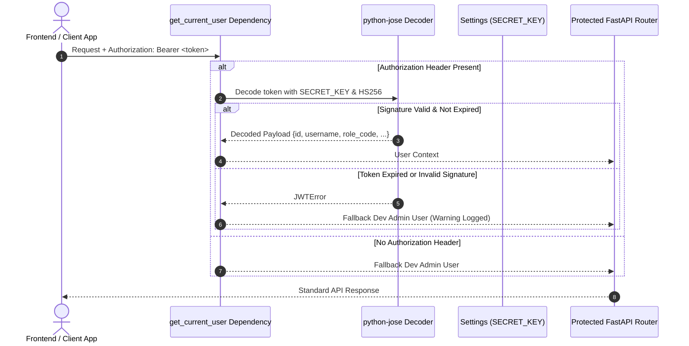

# Authentication & Security

## 1. Authentication Architecture

The platform uses JSON Web Tokens (JWT) for API request authentication, implemented in `backend/app/core/dependencies.py` and `backend/app/core/config.py`.



---

## 2. Token Handling & Verification

Tokens are verified using the `python-jose` library against the application's configured `SECRET_KEY` and `ALGORITHM` (defaults to `HS256`).

### Extraction Logic (`backend/app/core/dependencies.py`)
```python
security = HTTPBearer(auto_error=False)

def get_current_user(credentials: Optional[HTTPAuthorizationCredentials] = Depends(security)):
    if not credentials:
        # Fallback mock admin user for local development and Studio UI
        return {
            "id": 1,
            "username": "admin",
            "role_code": "admin",
            "user_type_name": "ADMIN",
            "email": "admin@example.com"
        }
        
    token = credentials.credentials
    try:
        payload = jwt.decode(
            token,
            settings.SECRET_KEY,
            algorithms=[settings.ALGORITHM]
        )
        if "user_type_name" not in payload:
            payload["user_type_name"] = "ADMIN"
        return payload
    except JWTError:
        # Fallback during local development testing
        return {
            "id": 1,
            "username": "admin",
            "role_code": "admin",
            "user_type_name": "ADMIN",
            "email": "admin@example.com"
        }
```

### Critical Security Finding: Development Fallback
> [!WARNING]
> **Active Development Fallback in `get_current_user`**:
> Because `HTTPBearer(auto_error=False)` is used and the function falls back to a default administrator dictionary when credentials are missing or invalid, endpoints requiring `current_user: dict = Depends(get_current_user)` **do not enforce strict authentication** in the current code. This was implemented to enable frictionless local development and standalone Studio designer testing without requiring an external identity provider.
> 
> **Production Remediation**: In a production environment with strict authorization requirements, `auto_error` must be set to `True`, and unauthenticated requests or `JWTError` exceptions must raise an `HTTPException(status_code=401, detail="Could not validate credentials")`.

---

## 3. Credential Encryption with Fernet

External database passwords configured via the UI (`DatabaseConnectionsModal.jsx`) are never stored in plaintext. They are encrypted using symmetric AES-128 (CBC mode) authenticated with HMAC-SHA256 via the Python `cryptography` Fernet implementation in `backend/app/core/security.py`.

```python
from cryptography.fernet import Fernet
from app.core.config import settings

cipher = Fernet(settings.FERNET_KEY.encode())

def encrypt_text(text: str) -> str:
    """Encrypts sensitive credentials before saving to PostgreSQL."""
    return cipher.encrypt(text.encode()).decode()

def decrypt_text(token: str) -> str:
    """Decrypts database passwords in memory for connection pooling."""
    return cipher.decrypt(token.encode()).decode()
```

### Fernet Key Requirements
- Must be a 32-byte URL-safe base64-encoded string.
- Validated at application startup via `backend/validate_env_secrets.py`.
- If the `FERNET_KEY` is changed or lost, all previously stored database connection passwords in `db_connections.password_encrypted` become unreadable and must be re-entered.

---

## 4. SQL Injection Protection

The platform connects to multiple client database engines (PostgreSQL, MySQL, Microsoft SQL Server, SQLite, Oracle) to execute dynamic CRUD nodes. To prevent SQL injection:
1. **Parameterized Queries**: All queries constructed in `backend/app/workflow_studio/runtime/actions.py` and `backend/app/core/database.py` use SQLAlchemy `text()` constructs with named parameter bindings (e.g. `:record_id`, `:param_0`).
2. **Identifier Whitelisting & Quoting**: Table and column names are validated against live schema introspection before queries are dispatched.
3. **AST Condition Evaluation**: In `ConditionEvaluator` (`backend/app/workflow_studio/runtime/actions.py`), branching expressions are parsed with regular expressions and typed comparisons rather than executing arbitrary Python `eval()` or unsanitized SQL `WHERE` clauses.

---

## 5. Network & CORS Configuration

### Cross-Origin Resource Sharing (CORS)
Configured in `backend/app/main.py`:
```python
app.add_middleware(
    CORSMiddleware,
    allow_origins=["*"],
    allow_credentials=True,
    allow_methods=["*"],
    allow_headers=["*"],
)
```
- For production deployments exposed beyond private LAN networks, `allow_origins` should be restricted to the specific frontend domain or the configured `MAIN_URL`.

### SSL / TLS Encryption
- Full HTTPS is supported via `backend/generate_ssl_certs.py`, generating 2048-bit RSA keys and X.509 certificates with Subject Alternative Names (SAN) for localhost and the server LAN IP.
- In production Docker deployment (`docker-compose.yml`), SSL termination is handled at the Nginx reverse proxy level on port `443`.

---

## 6. Secret Management Best Practices

1. **Environment Files**: The `.env` file is excluded from Git tracking via `.gitignore`.
2. **Template Provisioning**: `backend/.env.example` provides the template for required variables without real credentials.
3. **Atomic Pre-Flight Secret Validation**: `backend/validate_env_secrets.py` verifies all required secrets before deployment, ensuring keys have sufficient length and entropy without printing secret values to console or logs.
4. **Log Masking**: Request/response middleware masks any request body containing the key `"password"` with `"HIDDEN"`.

---

## 7. Related Documentation Links

- Backend Entry Point: [Backend Architecture](./backend-architecture.md)
- Security Audit: [Security Review](../08-quality-and-maintenance/security-review.md)
- Environment Setup: [Local Development Setup](../07-operations/local-development-setup.md)
