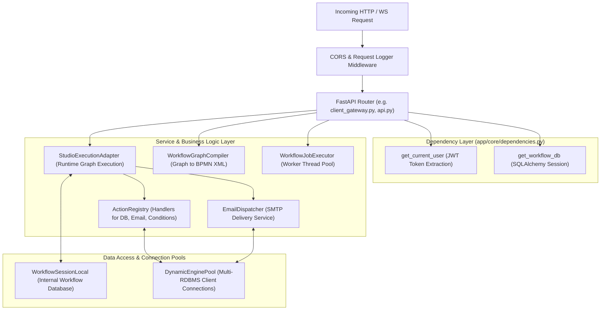

# Backend Architecture

## 1. Application Entry Point & Startup Sequence

The backend application is initialized in `backend/app/main.py`. It instantiates the FastAPI application, mounts CORS middleware, registers global exception handlers, configures request/response logging, and binds 15 modular routers.

```text
[Startup Execution Flow]
1. load_dotenv() loads variables from .env
2. app = FastAPI(title="Enterprise Workflow Engine & Studio API", version="2.0.0")
3. CORSMiddleware mounted (allows all origins, credentials, methods, headers)
4. Global exception handlers registered (StarletteHTTPException, RequestValidationError, Exception)
5. Request/Response logging middleware attached (@app.middleware("http"))
6. Pure Workflow & Studio routers included (definitions, tasks, monitoring, jobs, studio, gateway, hub)
7. Dynamic service task registration triggered (import generic_activities, custom_activities)
8. Startup Event (@app.on_event("startup")):
   - ws_manager.set_event_loop(asyncio.get_running_loop())
   - DatabaseTriggerWorker.start() initiated
9. Shutdown Event (@app.on_event("shutdown")):
   - DatabaseTriggerWorker.stop() executed cleanly
```

---

## 2. Router Organization & Module Breakdown

The backend routes are partitioned into dedicated domain modules:

| Router Module | Route Prefix | Primary Responsibilities | Source File |
| :--- | :--- | :--- | :--- |
| **Workflow Definitions** | `/workflow/definitions` | CRUD for BPMN process definitions, versions, and validation. | `backend/app/workflow/api/definitions.py` |
| **Workflow Tasks** | `/workflow/tasks` | Human task retrieval, completion (`/complete`), and rejection (`/reject`). | `backend/app/workflow/api/human_tasks.py` |
| **Workflow Monitoring**| `/workflow/monitoring` | Execution instances, variables, logs, telemetry, and metrics. | `backend/app/workflow/api/monitoring.py` |
| **Workflow Jobs** | `/workflow/jobs` | Job queue management, pause, resume, restart, and history. | `backend/app/workflow/api/jobs.py` |
| **Workflow Executor** | `/workflow/executor` | Thread pool status, pause/resume, and direct async job dispatch. | `backend/app/workflow/api/executor.py` |
| **Workflow Management**| `/workflow/definitions` | Enterprise lifecycle actions: publish, duplicate, export BPMN, deactivate. | `backend/app/workflow_management/api.py` |
| **Generic Definitions**| `/workflows` | Relational workflow graph CRUD (`wf_definition`, `wf_version`, `wf_node`). | `backend/app/workflow_definition/api.py` |
| **Workflow Inspection**| `/workflows` | Inspection endpoints for client applications, table lookup, and catalog. | `backend/app/workflow/api/workflows_api.py` |
| **Studio Core** | `/workflow-studio` | Visual canvas layout saving, node library, catalog, and graph validation. | `backend/app/workflow_studio/api.py` |
| **Database Connections**| `/workflow-studio/connections` | Dynamic client database profiles, connection testing, table & column introspection. | `backend/app/workflow_studio/connections_api.py` |
| **Client Gateway** | `/client` | External application data query, record submission, and action triggers. | `backend/app/workflow/api/client_gateway.py` |
| **Universal Hub** | `/api/v1/workflow-hub` | Centralized mediator endpoint executing workflows dynamically by `spec_id`. | `backend/app/workflow/api/workflow_hub_api.py` |
| **Logs API** | `/logs` | Centralized log queries, log file inspection, and frontend log ingestion. | `backend/app/core/logs_api.py` |
| **Health** | `/health` | Application health check returning service status and version. | `backend/app/main.py` |
| **WebSocket** | `/ws/workflow` | Full-duplex WebSocket connection for real-time event distribution. | `backend/app/main.py` |

---

## 3. Dependency Injection & Service Layers

The backend follows a layered separation of concerns:



---

## 4. Middleware & Request Lifecycle

FastAPI executes requests through two primary middleware components:

### 1. CORS Middleware
Configured in `backend/app/main.py` (lines 55–61):
- Allows all origins (`allow_origins=["*"]`)
- Allows credentials (`allow_credentials=True`)
- Allows all HTTP methods and request headers.

### 2. Request/Response Logging Middleware
Attached via `@app.middleware("http")` in `backend/app/main.py` (lines 142–180):
- **Request Capture**: Captures method, URL, and body payload. If the string `"password"` is found in the body, the log replaces the body with `"HIDDEN"` to prevent credential leakage.
- **Latency Measurement**: Computes execution duration with microsecond precision (`process_time = time.time() - start_time`).
- **Response Capture**: Logs HTTP status code, processing time, and response body text before streaming the response back to the client.

---

## 5. Background Jobs & Asynchronous Workers

The backend incorporates two distinct asynchronous worker architectures:

### 1. `WorkflowJobExecutor` (`backend/app/workflow/runtime/executor_service.py`)
- Employs a Python `concurrent.futures.ThreadPoolExecutor` (default 8 workers).
- Used for asynchronous workflow execution via `/workflow/executor/dispatch` or `submit_job_async`.
- Decouples long-running database mutations, email dispatches, and multi-step transitions from the client's HTTP request lifecycle.
- Maintains metrics (`active_tasks`, `total_submitted`, `total_completed`, `total_failed`, `queue_depth`) queryable via `/workflow/executor/status`.

### 2. `DatabaseTriggerWorker` (`backend/app/workflow_studio/runtime/db_trigger_worker.py`)
- Background `asyncio` task started on FastAPI startup (`@app.on_event("startup")`).
- Periodically scans client database tables configured with automated triggers (e.g., polling for newly inserted records matching specific conditions).
- Automatically invokes `StudioExecutionAdapter.start_workflow` when matching records are discovered.

---

## 6. Related Documentation Links

- API Specification: [API Reference](./api-reference.md)
- Security & Tokens: [Authentication & Security](./authentication-security.md)
- Exception Strategy: [Error Handling & Logging](./error-handling-logging.md)
- Runtime Execution: [Runtime Execution](../03-workflow-engine/runtime-execution.md)
