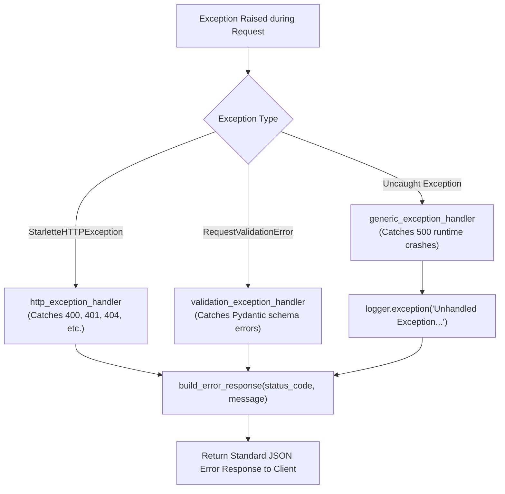

# Error Handling & Logging

## 1. Exception Handling Architecture

The platform uses centralized exception handling implemented in `backend/app/core/exception_handler.py`. Custom handlers format errors into a uniform JSON response structure to ensure predictable error parsing for both the Studio UI and external client applications.



---

## 2. Standard Error Response Structure

All exceptions mapped through `build_error_response` produce a consistent envelope:

```json
{
  "data": null,
  "Error": {
    "Success": false,
    "Error_message": "Invalid specification ID: workflow not found",
    "Code": 404
  }
}
```

### Registered Handlers in `backend/app/main.py`:
1. **`StarletteHTTPException`**:
   - Captures explicit HTTP status codes (e.g. `raise HTTPException(status_code=404, detail="...")`).
   - Maps the status code and error detail string directly to the envelope.
2. **`RequestValidationError`**:
   - Triggered when incoming request JSON violates Pydantic model schemas.
   - Responds with HTTP `422 Unprocessable Entity` and `"Validation Error"`.
3. **`Exception` (Generic Fallback)**:
   - Catches any unhandled Python runtime exception.
   - Emits a full stack trace to the server logs via `logger.exception()`.
   - Returns HTTP `500 Internal Server Error` with a sanitized `"Internal Server Error"` message to avoid exposing raw database errors or internal file paths to callers.

---

## 3. Enterprise Logging System

Logging is configured in `backend/app/core/logger.py`. It combines console logging, daily date-partitioned file handlers, 30-day log rotation, frontend log ingestion, and in-memory workflow telemetry.

```text
backend/logs/
├── app_2026-10-15.log       # Date-partitioned backend server log
├── app_2026-10-16.log       # Current active backend server log
└── frontend/
    ├── frontend_2026-10-15.log  # Browser console errors from Studio UI
    └── frontend_2026-10-16.log  # Current frontend error log
```

### Daily Date-Partitioned File Handler (`DailyDateFileHandler`)
- Thread-safe custom logging handler derived from `logging.Handler`.
- Automatically opens and writes to `{prefix}_{YYYY-MM-DD}.log`.
- When the date rolls over at midnight, the handler flushes, closes the previous file handle, and creates the new daily log file without requiring application restarts.
- Enabled for both the backend application log (`app_*.log`) and the frontend ingestion log (`frontend_*.log`).

### 30-Day Automated Retention (`cleanup_old_logs`)
- Routine running during log initialization that inspects the `logs/` directory.
- Deletes log files whose modification date is older than 30 days (`retention_days = 30`).

---

## 4. Frontend Log Ingestion

To assist debugging user actions and browser rendering issues, the frontend captures runtime errors and ships them to the backend via `frontend/src/services/frontendLogger.js`.

- **Endpoint**: `POST /logs/frontend/ingest`
- **Payload**:
  ```json
  {
    "level": "ERROR",
    "message": "Failed to render custom node 'condition_node_3'",
    "stack": "TypeError: Cannot read properties of undefined (reading 'operator')...",
    "url": "http://localhost:5173/?view=designer&id=4",
    "user_agent": "Mozilla/5.0 ...",
    "timestamp": "2026-10-16T11:20:00.000Z"
  }
  ```
- **Backend Action**: The endpoint formats the entry and commits it to `backend/logs/frontend/frontend_{YYYY-MM-DD}.log`.

---

## 5. In-Memory Workflow Telemetry Ring Buffer

For high-speed live monitoring in the UI without querying database disks repeatedly, `backend/app/core/logger.py` provides `WorkflowTelemetryLogger`.

- **Storage**: In-memory `collections.deque(maxlen=1000)`.
- **Recorded Events**: Node execution starts, transitions, database query latency, and branch evaluations.
- **API Access**:
  - `GET /workflow/monitoring/telemetry` — Fetches the latest 1000 entries.
  - `POST /workflow/monitoring/telemetry/clear` — Flushes the buffer.

---

## 6. Request/Response Middleware & Credential Masking

All incoming HTTP requests pass through the `@app.middleware("http")` logging middleware in `backend/app/main.py`:
- Logs HTTP method, URL path, and request body.
- **Sensitive Data Masking**: Scans the incoming payload. If the substring `"password"` is found, the body text is replaced with `"HIDDEN"` before being written to the log file.
- Logs HTTP status code, processing time in seconds (`time.time() - start_time`), and response body preview.

---

## 7. Related Documentation Links

- Backend Routing: [Backend Architecture](./backend-architecture.md)
- Complete Endpoint List: [API Reference](./api-reference.md)
- Telemetry & Monitoring: [Monitoring & Alerting](../07-operations/monitoring-and-alerting.md)
