# BPMN 2.0 Compiler

## 1. Compiler Overview

The **BPMN Compiler** (`backend/app/workflow/runtime/compiler.py`) is responsible for compiling visual workflow graph JSON structures into standard, valid BPMN 2.0 XML with Diagram Interchange (BPMNDI) coordinates.

This allows workflows designed in the visual Studio UI (`@xyflow/react`) to be exported and executed by BPMN-compliant execution engines (including `SpiffWorkflow` and Camunda Modeler).

---

## 2. Compilation Architecture & Mapping

```mermaid
flowchart LR
    VisualGraph["Visual Graph JSON\n{nodes, edges, positions}"] --> Compiler["WorkflowGraphCompiler\n(compiler.py)"]
    
    subgraph ElementMapping["Element Mapping Rules"]
        StartMap["start -> bpmn:startEvent"]
        TaskMap["approval / userTask -> bpmn:userTask\n(camunda:candidateGroups)"]
        EmailMap["email / communication -> bpmn:serviceTask\n(SendEmailActivity)"]
        DbMap["action / record -> bpmn:serviceTask\n(UpdateDatabaseActivity)"]
        GatewayMap["condition / gateway -> bpmn:exclusiveGateway"]
        EndMap["end / end_approved -> bpmn:endEvent"]
    end
    
    Compiler --> ElementMapping
    ElementMapping --> SequenceFlows["Sequence Flows & Conditions\n(bpmn:sequenceFlow + bpmn:conditionExpression)"]
    SequenceFlows --> LayoutGen["BPMNDI Diagram & Waypoints\n(bpmndi:BPMNShape, bpmndi:BPMNEdge)"]
    LayoutGen --> BPMNXML["Executable BPMN 2.0 XML Document"]
```



---

## 3. Supported BPMN 2.0 Construct Mappings

The compiler inspects each visual node's `type` and generates standard BPMN elements with appropriate namespaces:

| Visual Node Type | Generated BPMN 2.0 XML Construct | Attributes & Custom Extensions |
| :--- | :--- | :--- |
| **`start`**, `startevent` | `<bpmn:startEvent>` | `id="{node_id}"`, `name="{label}"` |
| **`approval`**, `usertask`, `human_task` | `<bpmn:userTask>` | `id="{node_id}"`, `camunda:candidateGroups="{role_code}"` |
| **`email`**, `communication` | `<bpmn:serviceTask>` | `camunda:class="SendEmailActivity"`, `camunda:topic="SendEmail"` |
| **`action`**, `record`, `dbupdate` | `<bpmn:serviceTask>` | `camunda:class="UpdateDatabaseActivity"`, `camunda:topic="UpdateDatabase"` |
| **`condition`**, `exclusivegateway`| `<bpmn:exclusiveGateway>` | `id="{node_id}"`, `default="{default_flow_id}"` |
| **`wait`**, `delay` | `<bpmn:intermediateCatchEvent>` | `id="{node_id}"`, `name="{label}"` |
| **`end`**, `end_approved`, `end_rejected`| `<bpmn:endEvent>` | `id="{node_id}"`, `name="{label}"` |

### Namespaces Registered in Compiled XML
- `bpmn`: `http://www.omg.org/spec/BPMN/20100524/MODEL`
- `bpmndi`: `http://www.omg.org/spec/BPMN/20100524/DI`
- `dc`: `http://www.omg.org/spec/DD/20100524/DC`
- `di`: `http://www.omg.org/spec/DD/20100524/DI`
- `camunda`: `http://camunda.org/schema/1.0/bpmn`

---

## 4. Sequence Flows & Condition Handling

Edges connecting nodes are translated into `<bpmn:sequenceFlow>` elements:

1. **Unconditional Flows**: Connect standard sequential steps (`sourceRef` and `targetRef`).
2. **Conditional Flows from Gateways**:
   When the source node is a condition or exclusive gateway:
   - The compiler scans outgoing edges to identify default flows (e.g. branches marked `FALSE`, `REJECT`, or `DEFAULT`).
   - For non-default flows, the compiler embeds a formal condition expression:
     ```xml
     <bpmn:sequenceFlow id="Flow_2" name="Approve" sourceRef="gw_1" targetRef="task_2">
       <bpmn:conditionExpression xsi:type="bpmn:tFormalExpression">
         action == 'APPROVE'
       </bpmn:conditionExpression>
     </bpmn:sequenceFlow>
     ```

---

## 5. Diagram Interchange (BPMNDI) Generation

The compiler preserves canvas layout fidelity by generating standard BPMNDI coordinates matching the visual positions of nodes:
- Each node produces a `<bpmndi:BPMNShape>` containing `<omgdc:Bounds>` with `x`, `y`, `width=100`, `height=80`.
- Each edge produces a `<bpmndi:BPMNEdge>` with calculated `<omgdi:waypoint>` coordinates connecting the right handle of the source node (`x + 100`, `y + 40`) to the left handle of the target node (`x`, `y + 40`).

---

## 6. Exporting BPMN 2.0 XML

Developers or process analysts can export the compiled BPMN 2.0 XML directly via the backend API:
- **Endpoint**: `GET /workflow/definitions/{id}/export`
- **Output**: Downloadable `.bpmn` XML file ready for import into external tools like Camunda Modeler, bpmn.io, or Enterprise Architect.

---

## 7. Unsupported BPMN Constructs

To avoid misrepresenting engine capabilities, the following advanced BPMN 2.0 constructs are **not generated** by the compiler:
- Complex multi-instance parallel loop characteristics (`<bpmn:multiInstanceLoopCharacteristics>`).
- Boundary error catch events attached to sub-processes (`<bpmn:boundaryEvent>`).
- Transactional sub-processes with compensation handlers (`<bpmn:transaction>`).
- Message intermediate throw/catch events (`<bpmn:intermediateThrowEvent>`).

---

## 8. Related Documentation Links

- Engine Architecture: [Engine Architecture](./engine-architecture.md)
- Node Inventory: [Activities & Node Inventory](./activities-and-nodes.md)
- Visual Designer: [Workflow Designer](../04-frontend/workflow-designer.md)
