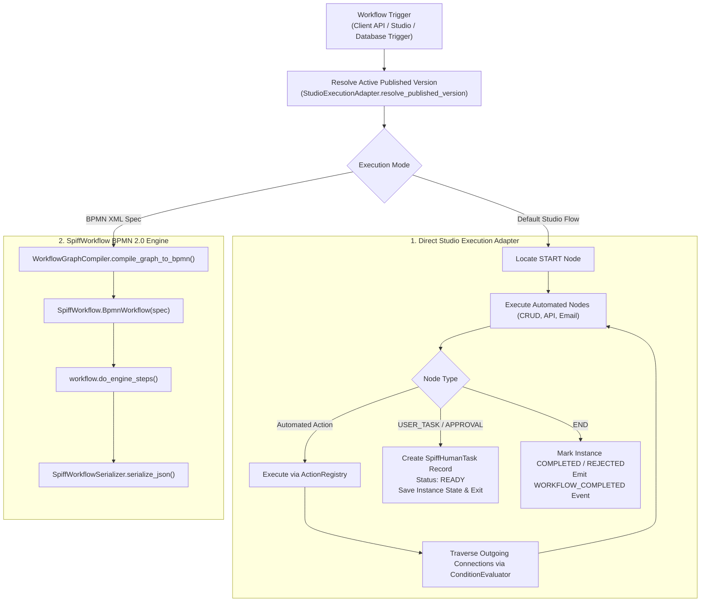

# Workflow Engine Architecture

## 1. Engine Architecture & Dual Abstraction

The workflow execution engine in WorkFlow-Automation is designed to accommodate both BPMN 2.0 standards and visual graph-based business process automation.

The platform provides two complementary execution layers:
1. **`StudioExecutionAdapter` (`backend/app/workflow_studio/runtime/adapter.py`)**:
   The primary execution engine powering the Visual Workflow Studio. It executes versioned relational graphs (`GenericWorkflow`, `WorkflowVersion`, `WorkflowNode`, `WorkflowConnection`) directly. It provides fast graph traversal, automatic state transitions for automated steps, human approval gate pausing, and synchronized updates to client application databases.
2. **`SpiffWorkflowEngine` (`backend/app/workflow/runtime/engine.py`)**:
   A wrapper around the open-source `SpiffWorkflow` (v3.1.2) library. It parses BPMN 2.0 XML specifications generated by `WorkflowGraphCompiler`, handles workflow instance state serialization, and provides strict adherence to BPMN standards for supported constructs.

---

## 2. Core Engine Components

### A. Studio Execution Adapter (`StudioExecutionAdapter`)
Located in `backend/app/workflow_studio/runtime/adapter.py`:
- **`resolve_published_version(db, entity_type, definition_id)`**: Resolves the target workflow definition and its highest published version.
- **`start_workflow(...)`**: Initializes a new workflow instance, validates the trigger record, injects context variables, records initial `workflow_history`, and begins graph traversal.
- **`execute_action(...)`**: Resumes a paused workflow instance when an actor submits a human task decision (`APPROVE`, `REJECT`), verifies role authorization, updates the task record, and advances the workflow.
- **`_advance_graph(...)`**: Resolves outgoing connections from the current node, evaluates condition expressions using `ConditionEvaluator`, and continues execution along active branches.

### B. Action Registry (`ActionRegistry`)
Located in `backend/app/workflow_studio/runtime/actions.py`:
- Central registry mapping node types and action identifiers to concrete Python execution handlers.
- Pre-registered handlers include:
  - `_db_create_handler`: Inserts a new record into the client database (`CREATE_RECORD`).
  - `_db_read_handler`: Queries records and binds results into context variables (`READ_RECORD`).
  - `_db_update_handler`: Updates targeted entity fields in the client database (`UPDATE_RECORD`).
  - `_email_notification_handler`: Dispatches templated emails via `EmailDispatcher` (`COMMUNICATION`).
  - `_update_status_handler`: Synchronizes entity status flags upon transitions.
  - `_log_audit_handler`: Appends state changes to `workflow_history`.

### C. Condition Evaluator (`ConditionEvaluator`)
Located in `backend/app/workflow_studio/runtime/actions.py`:
- Safely evaluates branch conditions, action buttons, numeric thresholds, and string equalities without using unsafe Python `eval()`.
- Supports:
  - Direct action matching: `APPROVE`, `REJECT`, `SUBMIT`.
  - Equality / inequality: `action == 'APPROVE'`, `status != 'PENDING'`.
  - Template variable boolean checks: `{{is_high_risk}} == true`.
  - Numeric comparisons: `{{amount}} > 100000`, `risk_score >= 70`.
  - String comparisons: `{{department}} == "FINANCE"`.

### D. SpiffWorkflow Wrapper (`SpiffWorkflowEngine`)
Located in `backend/app/workflow/runtime/engine.py`:
- Encapsulates `SpiffWorkflow.bpmn.workflow.BpmnWorkflow`.
- Serializes and deserializes running workflow states to and from JSON for persistent database storage (`spiff_workflow_instance.serialized_state`).
- Manages execution steps via `run_until_blocked(workflow)` using `workflow.do_engine_steps()`.
- Queries waiting user tasks via `get_ready_user_tasks(workflow)`.

---

## 3. Persistence Interactions

During execution, the engine coordinates state between multiple database tables:

| Entity / Table | Role in Engine Execution |
| :--- | :--- |
| **`wf_version`** | Immutable snapshot containing the nodes and connections being executed. |
| **`spiff_workflow_instance`** | Tracks execution status (`Running`, `Completed`, `Rejected`), current step code, and serialized state. |
| **`workflow_human_task`** | Created when a workflow hits a `USER_TASK` or `APPROVAL` node. Stores the assigned `role_code`, `status` (`READY`), and timestamps. |
| **`workflow_history`** | Immutable chronological audit trail recording each state transition, actor ID, action code, and remarks. |
| **`workflow_activity_history`**| Granular step-level tracing recording inputs, outputs, errors, and execution timestamps for each node. |

---

## 4. Integration with API Layer

1. **Client Gateway Integration**:
   When an external system calls `POST /client/submit/{module_code}` or `POST /client/action/{module_code}`, the request parameters are routed directly to `StudioExecutionAdapter.start_workflow` or `StudioExecutionAdapter.execute_action`.
2. **Universal Hub Integration**:
   When `POST /api/v1/workflow-hub` is called, the hub resolves the bound `spec_id` or table name, maps incoming parameters into the runtime variable context, and executes the adapter.
3. **WebSocket Notification**:
   Upon every state transition, the adapter calls `ws_manager.broadcast_event` to notify connected UI clients in real time (`WORKFLOW_STARTED`, `TASK_READY`, `TASK_COMPLETED`, `WORKFLOW_COMPLETED`).

---

## 5. Related Documentation Links

- Process Lifecycle: [Workflow Lifecycle](./workflow-lifecycle.md)
- BPMN Compilation: [BPMN Compiler](./bpmn-compiler.md)
- Node Inventory: [Activities & Node Inventory](./activities-and-nodes.md)
- Human Task Handling: [Human Tasks & Approvals](./human-tasks-and-approvals.md)
