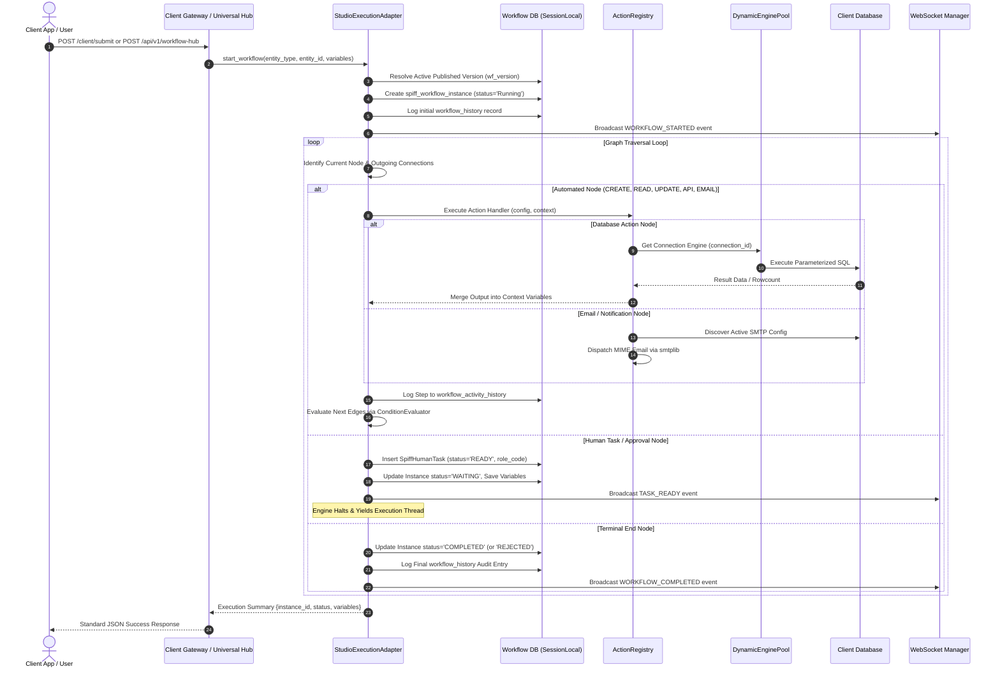

# Runtime Execution

## 1. Execution Orchestration Overview

Workflow execution is orchestrated through two primary mechanisms:
1. **Synchronous Execution (`StudioExecutionAdapter`)**:
   Executed in-line with incoming HTTP requests (e.g., standard approvals or quick triggers). Traverses graph nodes until hitting a human gate or terminal state, returning the updated state in < 50ms.
2. **Asynchronous Execution (`WorkflowJobExecutor`)**:
   Enqueues execution tasks into an internal thread pool (`ThreadPoolExecutor`). Returns an immediate HTTP 202 `QUEUED` response, allowing long-running database bulk operations, outbound webhooks, or multi-step processes to run without blocking the client.

---

## 2. Execution Sequence Trace

---

## 3. Execution Context & Variable Management

Execution context is maintained as a standard Python dictionary passed to every node handler and updated as steps complete:

### Standard Context Keys
- `entity_id`: Primary key of the business entity triggering the flow.
- `entity_type`: Target domain entity code (e.g., `leave_requests`, `risk_register`).
- `user_id`: Numeric identifier of the actor initiating or advancing the step.
- `user_name`: Display name of the current actor.
- `user_email`: Email address of the current actor.
- `connection_id`: ID of the target client database connection profile.
- Dynamic fields: Any variables generated by upstream steps (e.g. `{{amount}}`, `{{status}}`, `{{api_response}}`).

### Variable Sanitization for Observability
In `backend/app/workflow/api/monitoring.py` (`_sanitize_monitoring_variables`), context variables are sanitized before being transmitted to the frontend:
- Recursive dictionaries deeper than 4 levels are truncated.
- Redundant cloned parameter dictionaries are stripped.
- Arrays longer than 50 items are truncated.
- String values exceeding 2,000 characters or containing base64 data URIs (`data:image/...`) are replaced with summary tokens (e.g. `[Large Binary / Base64 Payload: 1.25 MB]`) to prevent browser freezing.

---

## 4. Error Propagation & Failure Behavior

When an automated node fails during execution:
1. **Try-Catch Encapsulation**: The action registry catches the underlying exception (e.g., database network timeout, foreign key constraint violation, invalid HTTP response).
2. **Activity Trace Record**: A record is written to `workflow_activity_history` with `status = 'FAILED'` and the exact exception text recorded in `error_message`.
3. **Instance State Update**: The workflow instance in `spiff_workflow_instance` is updated to `status = 'FAILED'`.
4. **WebSocket Notification**: An event of type `JOB_FAILED` is broadcast to connected monitoring clients.
5. **Session Rollback**: The workflow database session rolls back any uncommitted metadata changes.

---

## 5. Thread Safety & Concurrency

- **Connection Pool Isolation**: `DynamicEnginePool` manages thread-safe cached SQLAlchemy engines using an internal `threading.Lock()`.
- **Database Sessions**: FastAPI route handlers receive isolated database sessions via the `get_workflow_db` dependency (`sessionmaker(autocommit=False, autoflush=False)`), ensuring request isolation.
- **Worker Thread Pool**: `WorkflowJobExecutor` runs jobs in named threads (`WfExecutorWorker_X`), with synchronized metric counters protected by `self._lock`.

---

## 6. Related Documentation Links

- Engine Architecture: [Engine Architecture](./engine-architecture.md)
- Activities Inventory: [Activities & Node Inventory](./activities-and-nodes.md)
- Database Pooling: [Client Database Integration](../05-database/client-database-integration.md)
- Real-time Events: [WebSocket Events](../06-integrations/websocket-events.md)
