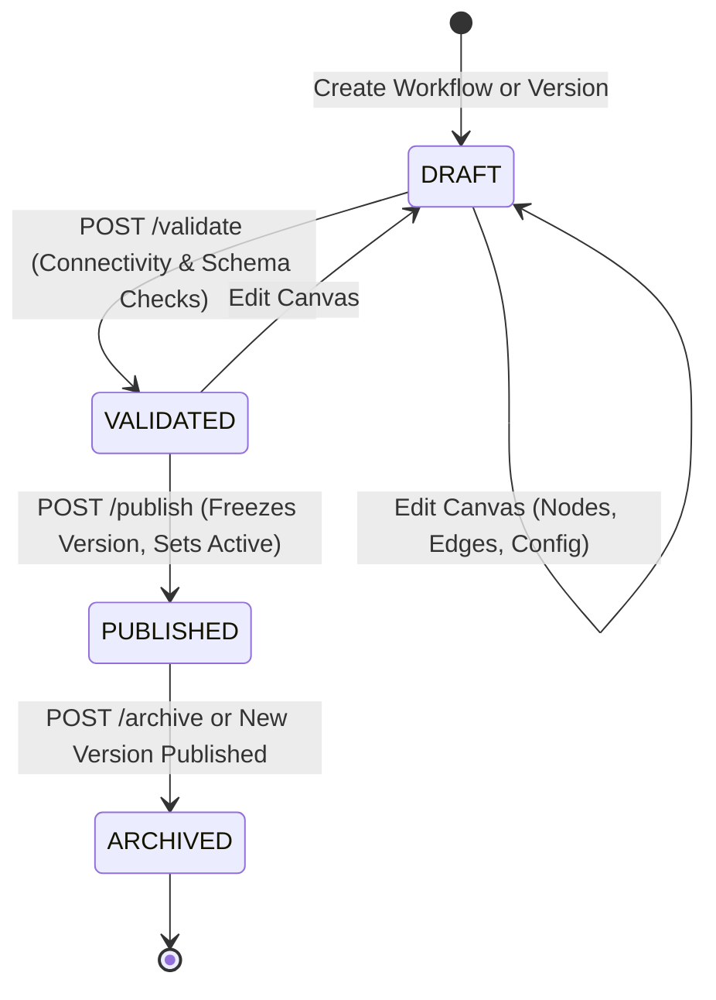
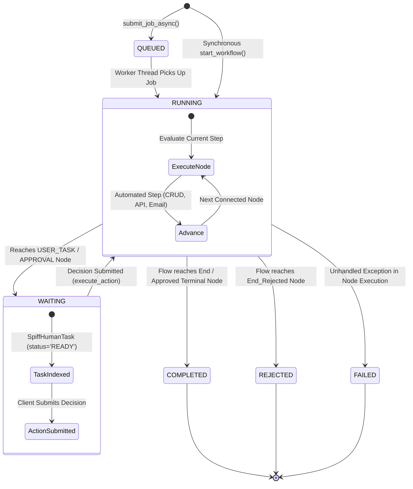

# Workflow Lifecycle

## 1. Lifecycle Overview

The WorkFlow-Automation platform manages two distinct lifecycle state machines:
1. **Design-Time Workflow Definition Lifecycle**: The evolution of workflow specifications, from initial drafting and canvas editing to validation, publishing, and archiving.
2. **Runtime Execution Instance Lifecycle**: The state transitions of an active workflow execution, from initial triggering and automated execution to human task waiting, completion, rejection, or failure.

---

## 2. Design-Time Workflow Definition Lifecycle

Workflow specifications evolve through distinct versioned states managed in `backend/app/workflow_definition/models.py` (`wf_version.status`):

### Definition Lifecycle States
- **`DRAFT`**: The working version of a workflow graph. The process designer can add, edit, move, or remove nodes and connections. Runtime execution does not use draft versions for production client app triggers.
- **`VALIDATED`**: The graph has successfully passed structural validation (verifying exactly one active `START` node, reachable `END` nodes, valid connection bindings, and complete node configurations).
- **`PUBLISHED`**: The version is marked immutable. Newly triggered workflow instances automatically resolve to this published version. Any existing running instances continue executing against the version they were started with.
- **`ARCHIVED`**: A previously published version that has been superseded by a newer published version or manually deactivated. Existing instances may finish executing, but no new instances will bind to an archived version.

---

## 3. Runtime Execution Instance Lifecycle

When a workflow is triggered (via Client Gateway, Universal Hub, or Database Trigger), a runtime instance is created in `spiff_workflow_instance`:

### Runtime States & Transition Rules

| State Code | Trigger / Transition Event | Engine Action |
| :--- | :--- | :--- |
| **`QUEUED`** | Asynchronous job submitted via `WorkflowJobExecutor.submit_job_async()`. | Job record inserted into `workflow_jobs` with status `QUEUED`. Waits for available thread in worker pool. |
| **`RUNNING`** | Worker starts job, or synchronous trigger via `StudioExecutionAdapter.start_workflow()`. | Executes automated steps in sequence (record creation, SQL reads, API calls, emails) without stopping. |
| **`WAITING`** | Engine encounters a `USER_TASK` or `APPROVAL` node requiring human interaction. | Pauses graph execution. Inserts a record in `workflow_human_task` with status `READY` and role/user assignment. Serializes execution context and halts execution thread. |
| **`COMPLETED`**| Flow reaches a terminal `END` node with positive outcome (e.g., `End_Approved`). | Marks instance `status = 'COMPLETED'`, stamps `completed_on = NOW()`, syncs client DB status if configured, and emits `WORKFLOW_COMPLETED` WebSocket event. |
| **`REJECTED`** | Flow reaches an `END` node designated as rejected or terminal termination. | Marks instance `status = 'REJECTED'`, stamps `completed_on = NOW()`, updates client DB record, and emits `WORKFLOW_COMPLETED` WebSocket event. |
| **`FAILED`** | An automated node fails (e.g. database connection error, invalid API call, network timeout). | Catches exception, records error message in `workflow_activity_history`, updates instance `status = 'FAILED'`, and broadcasts `JOB_FAILED` event. |

---

## 4. Unsupported or Constrained Lifecycle Operations

To maintain database integrity, certain lifecycle operations are explicitly constrained in the current implementation:
1. **In-Flight Workflow Definition Migration**:
   Running instances are bound to the specific version ID (`wf_version.workflow_version_id`) under which they were started. There is currently **no automated state migration** to upgrade an in-flight paused instance to a newer published version.
2. **Arbitrary Step Rollback**:
   While the engine supports rejection loops back to previous approval tasks (by drawing an edge labeled `REJECT` targeting an earlier node), arbitrary programmatic rollbacks of executed database mutations (`CREATE_RECORD` or `UPDATE_RECORD`) are not automatically rolled back by the engine; compensations must be modeled explicitly in the graph.
3. **Instance Cancellation**:
   Instances can be stopped or paused via the Jobs API (`POST /workflow/jobs/{job_id}/stop`), which marks the background execution job stopped. However, an arbitrary external `CANCEL` command for a running synchronous instance without a job record is not currently supported.

---

## 5. Related Documentation Links

- Engine Architecture: [Engine Architecture](./engine-architecture.md)
- Activities & Nodes: [Activities & Node Inventory](./activities-and-nodes.md)
- Human Task Management: [Human Tasks & Approvals](./human-tasks-and-approvals.md)
- Versioning Rules: [Workflow Versioning](./workflow-versioning.md)
