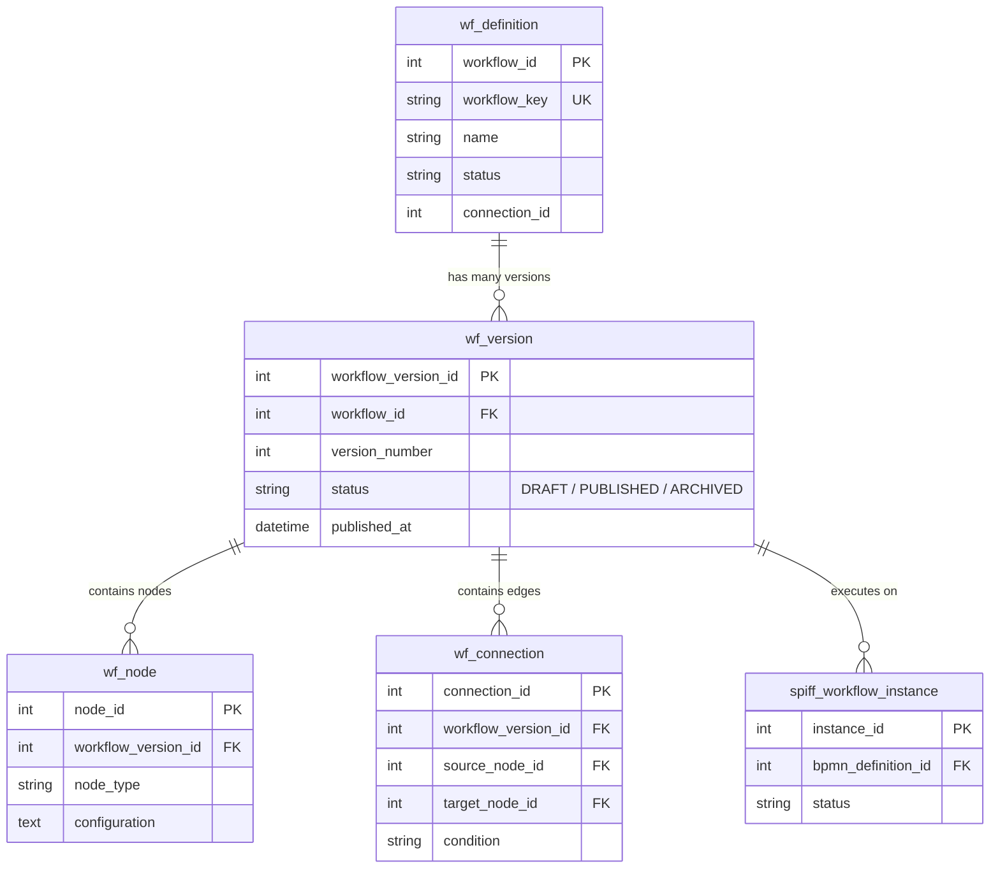

# Workflow Versioning

## 1. Versioning Architecture

The WorkFlow-Automation platform implements a strict immutable versioning pattern for workflow definitions. This ensures that modifications made to a workflow graph in the Visual Studio designer do not corrupt or disrupt in-flight execution instances.



---

## 2. Version Lifecycle & Progression

1. **Initial Creation**:
   When a new workflow is created (e.g. `LEAVE_APPROVAL`), the engine creates a parent record in `wf_definition` and initializes version `1` in `wf_version` with `status = 'DRAFT'`.
2. **Draft Editing**:
   Nodes (`wf_node`) and connections (`wf_connection`) added in the Visual Studio designer are bound directly to `workflow_version_id` of the current draft.
3. **Publication & Immutability**:
   When the designer clicks **Publish**:
   - The graph undergoes validation checks (`POST /workflows/{id}/versions/{version_id}/validate`).
   - The version status is updated: `status = 'PUBLISHED'`, and `published_at = NOW()`.
   - Any prior version with `status = 'PUBLISHED'` is transitioned to `status = 'ARCHIVED'`.
   - Once published, nodes and edges belonging to that `workflow_version_id` are treated as **immutable**.
4. **Subsequent Modifications**:
   If an administrator or process designer makes changes to an already-published workflow:
   - A new version record is created with `version_number = N + 1` and `status = 'DRAFT'`.
   - The node and connection graph from version `N` is cloned into version `N + 1`.
   - The designer edits the new draft without impacting production traffic.

---

## 3. Runtime Version Resolution

When an external client application or trigger initiates a workflow:
1. The engine calls `StudioExecutionAdapter.resolve_published_version(db, entity_type, definition_id)`.
2. The query selects:
   ```sql
   SELECT * FROM wf_version 
   WHERE workflow_id = :wf_id 
     AND status = 'PUBLISHED' 
   ORDER BY version_number DESC 
   LIMIT 1;
   ```
3. New instances are bound exclusively to the resolved published version.

### In-Flight Instance Isolation
Instances already running when a new version is published continue executing against their original `workflow_version_id`. The engine traverses the nodes and connections associated with the version stamped on the instance at creation time.

---

## 4. Current Versioning Limitations

- **No Live Instance State Migration**:
  The platform does not support migrating an in-flight, waiting approval instance from Version 1 to Version 2 if the node topology has changed. Instances must complete execution under their initial version.
- **Rollback Procedure**:
  There is no single-click "revert" button; to roll back to an earlier version, the earlier version's graph must be cloned as a new version `N + 1` and republished.

---

## 5. Related Documentation Links

- Engine Architecture: [Engine Architecture](./engine-architecture.md)
- Lifecycle States: [Workflow Lifecycle](./workflow-lifecycle.md)
- Schema Definitions: [Workflow Schema](../05-database/workflow-schema.md)
