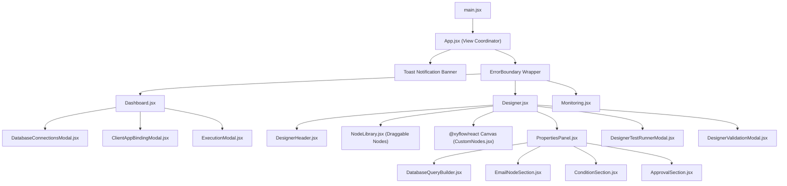

# Frontend Architecture

## 1. Frontend Architecture Overview

The **Workflow Studio** frontend is a high-performance single-page application (SPA) built using **React 19**, **Vite 8**, and **@xyflow/react**. It delivers a clean, responsive desktop-class canvas for designing, validating, simulating, and monitoring business processes.

```text
frontend/
├── index.html                   # HTML5 shell with Google Font typography
├── package.json                 # Dependencies (React 19, @xyflow/react, Lucide)
├── vite.config.js               # Dynamic backend proxy & SSL auto-discovery
├── nginx.conf                   # Production reverse proxy with SSL termination
└── src/
    ├── main.jsx                 # Application entry point
    ├── App.jsx                  # Main view coordinator & state routing
    ├── index.css                # Enterprise design system tokens & CSS utilities
    ├── services/
    │   ├── workflowStorage.js   # Centralized API service client (HTTP & WS)
    │   └── frontendLogger.js    # Browser error logger shipping to backend
    └── components/
        ├── Dashboard.jsx        # Process library, cards, lifecycle controls
        ├── Designer.jsx         # Visual @xyflow canvas and workflow editor
        ├── Monitoring.jsx       # Real-time instance execution traces & logs
        ├── NodeLibrary.jsx      # Draggable node palette
        ├── PropertiesPanel.jsx  # Context-aware node properties editor
        ├── ExecutionModal.jsx   # Manual workflow trigger modal
        ├── DatabaseConnectionsModal.jsx # Multi-database profile manager
        ├── ClientAppBindingModal.jsx    # Table/module binding modal
        ├── common/              # ErrorBoundary components
        ├── designer/            # Header, test runner modal, validation modal
        ├── nodes/               # Custom React Flow node components (CustomNodes.jsx)
        └── properties/          # Tabbed property inspectors & query builders
```

---

## 2. Navigation & State Routing

The frontend does not use heavy third-party routing libraries like `react-router-dom`. Instead, it uses a lightweight, URL-synchronized view router in `frontend/src/App.jsx`:

### View Modes
1. **`dashboard`** (Default): Overview of all workflow definitions, active versions, and configuration modals.
2. **`designer`** (`?view=designer&id={workflow_id}`): Dedicated full-screen canvas for editing a specific workflow graph.
3. **`monitoring`** (`?view=monitoring`): Live execution dashboard displaying active instances, activity traces, and telemetry.

### State Synchronization
- Navigating to a view (`navigateTo(view, id)`) synchronizes state across:
  - React component state (`currentView`, `selectedWorkflowId`).
  - Browser URL parameters using `window.history.replaceState()`.
  - LocalStorage keys (`studio_active_view`, `studio_active_wf_id`) to ensure the user returns to their exact workspace upon page reload.

---

## 3. Component Hierarchy & Flow



---

## 4. Error Boundaries & Resiliency

To prevent an unexpected rendering error in a custom node from crashing the entire application, the frontend employs a two-tier error boundary architecture:
1. **`GlobalErrorBoundary.jsx` (`src/components/common/GlobalErrorBoundary.jsx`)**:
   Catches fatal application-level crashes and provides a graceful full-page recovery screen.
2. **Component-Level `ErrorBoundary` (`src/App.jsx`)**:
   Wraps the `Designer` workspace. If a malformed node JSON or unhandled property crashes rendering, the error boundary isolates the failure, displays an informative alert banner with the error message, and offers a button to reset the canvas without losing external application state.
3. **Frontend Error Logging (`src/services/frontendLogger.js`)**:
   Uncaught errors captured by boundaries are automatically formatted and POSTed to `/logs/frontend/ingest` on the backend server.

---

## 5. Design System & Theming

The platform's styling is defined in `frontend/src/index.css` using curated CSS custom properties (variables):
- **Color Palette**: Modern dark/light neutral surfaces (`--color-surface-bg`, `--color-surface-card`), accent indigos (`#6366f1`), semantic greens (`--color-success`), ambers (`--color-warning`), and reds (`--color-error`).
- **Typography**: Clean system font stacks and Outfit / Inter typography for optimal readability in complex node graphs.
- **Glassmorphism & Modals**: Smooth translucent backdrops (`backdrop-filter: blur(8px)`), rounded borders (`border-radius: 8px`), and subtle micro-shadows.

---

## 6. Build & Proxy Configuration

In `frontend/vite.config.js`:
- **SSL Auto-Discovery**: Automatically checks for the presence of SSL certificates in `backend/certs/fullchain.pem` and toggles Vite HTTPS mode accordingly.
- **Backend API Reverse Proxy**: Proxies `/workflow`, `/workflows`, `/workflow-studio`, `/client`, `/api`, `/logs`, `/health`, and `/ws` to the FastAPI backend running on port `8000`, eliminating CORS issues during development.
- **Production Build**: Bundled via `npm run build` into `dist/` and served via Nginx in containerized environments.

---

## 7. Related Documentation Links

- Designer Canvas: [Workflow Designer](./workflow-designer.md)
- Node Configuration: [Node Configuration Panels](./node-configuration.md)
- Monitoring Views: [Execution & Monitoring UI](./execution-and-monitoring-ui.md)
- API Services: [Frontend API Integration](./frontend-api-integration.md)
