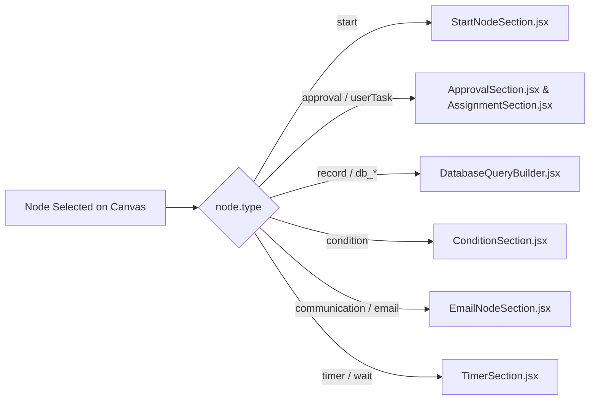

# Node Configuration Panels

## 1. Overview & Properties Dock

When a node is selected on the designer canvas, the right-hand **Properties Panel** (`frontend/src/components/PropertiesPanel.jsx`) opens dynamically. It mounts specialized property inspectors based on the selected node's `type`:



---

## 2. Specialized Property Inspectors

### A. Database Query Builder (`DatabaseQueryBuilder.jsx`)
Used by `CREATE_RECORD`, `READ_RECORD`, `UPDATE_RECORD`, and `DELETE_RECORD` nodes:
- **Connection Selector**: Dropdown listing active database profiles fetched live from `/workflow-studio/connections`.
- **Table Selector**: Dynamic dropdown populating all tables and views introspected from the selected connection.
- **Visual Schema Grid**:
  - Automatically fetches column definitions (`name`, `data_type`, `is_nullable`, `is_primary_key`).
  - Allows mapping fields to runtime variables (e.g. `{{user_id}}`, `{{entity_id}}`), static strings, or SQL presets (`NOW()`, `CURRENT_DATE`, `true`, `false`).
- **Conflict Handling**: Selectable conflict policies for `INSERT` operations:
  - `DO NOTHING` (ignores duplicate primary key errors).
  - `DO UPDATE` (updates existing record columns upon conflict).
- **Live SQL Preview**: Generates real-time parameterized SQL previews and offers a `▶ Test Query` button to execute against the target database during design time.

---

### B. Approval & Human Task Inspector (`ApprovalSection.jsx`)
Used by `APPROVAL` and `USER_TASK` nodes:
- **Role Assignment**: Dynamic dropdown loaded from the client database's live master roles table (`mst_user_role` or `/workflow-studio/connections/{id}/roles`).
- **Department & User Scoping**: Optional filtering by department (`mst_department`) or specific user ID (`mst_users`).
- **Action Buttons**: Configurable list of decision buttons presented to the approver (e.g., `APPROVE`, `REJECT`, `REQUEST_CHANGES`, `ESCALATE`).
- **SLA & Escalation**: Input fields for turnaround time thresholds (`sla_hours`).
- **Mandatory Comments**: Checkbox enforcing that approvers must provide remarks when selecting a rejection action.

---

### C. Condition Inspector (`ConditionSection.jsx`)
Used by `CONDITION` and `SWITCH` nodes:
- **Rule Builder**:
  - `Field`: Variable name or entity field to evaluate (e.g., `amount`, `department`, `risk_level`).
  - `Operator`: Dropdown offering `equals` (`==`), `not_equals` (`!=`), `greater_than` (`>`), `less_than` (`<`), `greater_than_or_equals` (`>=`), `less_than_or_equals` (`<=`).
  - `Value`: Target comparison value.
- **Expression Mode**: Toggle allowing advanced users to write multi-clause string expressions (e.g. `amount > 50000 and status == "ACTIVE"`).

---

### D. Email & Notification Inspector (`EmailNodeSection.jsx`)
Used by `COMMUNICATION` nodes:
- **Recipients**: Inputs for `To`, `CC`, and `BCC` fields supporting variable chips (e.g. `{{requester_email}}`, `{{manager_email}}`).
- **SMTP Server Selector**: Option to bind to a specific email server configuration or use the default active client SMTP server.
- **Template Body Editor**: Rich text and HTML template editor with dynamic chip insertion allowing seamless embedding of process variables into the email text:
  ```html
  <p>Hello {{employee_name}},</p>
  <p>Your request #{{entity_id}} has been approved by {{approver_name}}.</p>
  ```
- **Live HTML Preview**: Embedded rendering preview showing exactly how the email will display to the recipient.

---

### E. Start Node Inspector (`StartNodeSection.jsx`)
- **Trigger Mode**: Configures whether the flow is triggered via `Client App API`, `Database Event Trigger`, or `Manual Studio Execution`.
- **Parameter Definitions**: Defines expected input fields and validation schemas for client submissions.

---

## 3. Serialization to Node Configuration JSON

When values in any inspector change:
1. The inspector calls `onFieldChange(key, value)`.
2. The parent `PropertiesPanel` merges the update into the node's `data` and `config` objects.
3. The change reflects immediately on the canvas node card badge.
4. Upon canvas save, the JSON configuration is persisted to `wf_node.configuration`.

---

## 4. Related Documentation Links

- Visual Designer: [Workflow Designer](./workflow-designer.md)
- Activities Inventory: [Activities & Node Inventory](../03-workflow-engine/activities-and-nodes.md)
- Database Introspection: [Client Database Integration](../05-database/client-database-integration.md)
