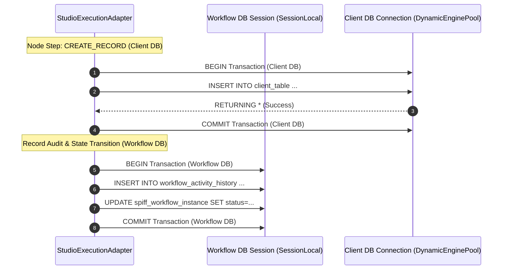

# Persistence & Transactions

## 1. Transaction Boundaries & The Dual-Database Challenge

Because WorkFlow-Automation coordinates actions across two independent databases (the internal Workflow Engine Database and external Client Application Databases), understanding transaction boundaries is essential for platform developers.



---

## 2. Non-Distributed Transactional Guarantees

> [!IMPORTANT]
> **No Distributed Two-Phase Commit (2PC)**:
> The platform intentionally does not use distributed XA transactions or two-phase commit protocols across the workflow database and client databases. Distributed transactions introduce severe latency and locking overhead across heterogeneous database engines (e.g. coordinating PostgreSQL with MySQL or MSSQL).

### Operational Failure Boundaries:
1. **Client DB Failure**:
   If an operation on the client database fails (e.g., duplicate key error, foreign key violation, network drop):
   - The client database connection rolls back its transaction immediately.
   - The workflow database transaction records the failure in `workflow_activity_history` with the error message and sets the instance status to `FAILED`.
   - The overall workflow halts safely without corrupting client state.
2. **Workflow DB Failure After Client DB Commit**:
   In the rare event that a client database update succeeds but the subsequent workflow state commit fails (e.g., sudden workflow database crash):
   - The business record in the client database will remain modified.
   - The workflow instance state will not have advanced to the next node.
   - **Remediation**: The platform exposes the activity history trace so administrators can inspect the failure and use the in-app test runner or jobs restart API (`POST /workflow/jobs/{id}/restart`) to resume the step.

---

## 3. Session Lifecycle in FastAPI

Database sessions are managed via FastAPI dependency injection:

```python
# backend/app/workflow/database.py
def get_workflow_db():
    db = WorkflowSessionLocal()
    try:
        yield db
    finally:
        db.close()
```

### Lifecycle Rules:
- **One Session Per Request**: Each HTTP request receives a dedicated, non-shared `Session` instance.
- **Explicit Commits**: Endpoints and adapters call `db.commit()` only after verifying that all required state updates have succeeded.
- **Guaranteed Cleanup**: The `finally: db.close()` block ensures that connection handles are returned to the pool even if an unhandled exception occurs during request execution.

---

## 4. Audit Trail Immutability

The `workflow_history` table serves as an append-only audit trail:
- Records are strictly inserted (`INSERT INTO workflow_history ...`).
- No API endpoint or adapter routine provides an `UPDATE` or `DELETE` path for `workflow_history` rows.
- Every state transition logs:
  - `performed_by` (actor user ID)
  - `performed_role` (assigned role at time of execution)
  - `action_name` (action code)
  - `from_state_code` & `to_state_code`
  - `remarks` (actor comments)
  - `performed_on` (timestamp)

---

## 5. Related Documentation Links

- Database Architecture: [Database Architecture](./database-architecture.md)
- Schema Definitions: [Workflow Schema](./workflow-schema.md)
- Client DB Integration: [Client Database Integration](./client-database-integration.md)
