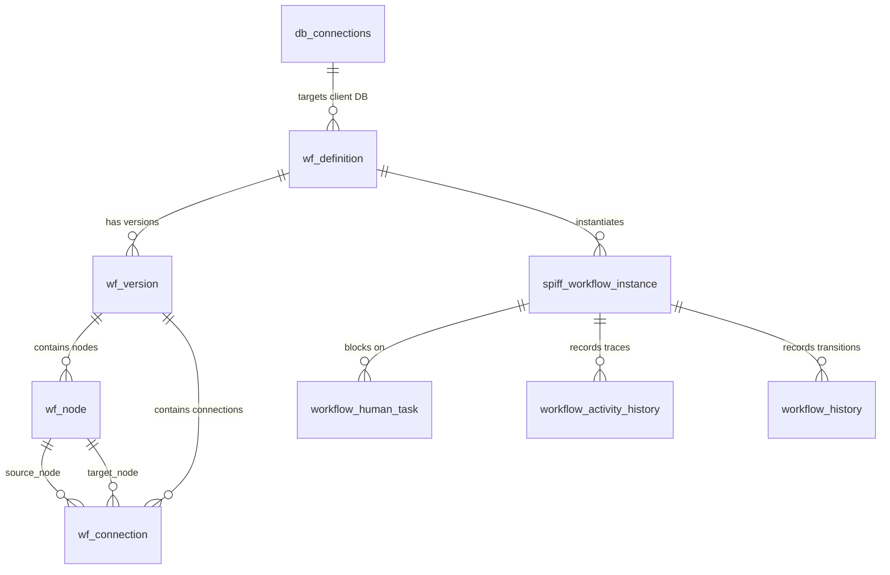

# Workflow Schema

This document provides a complete technical reference for all database models and tables maintained in the **Workflow Engine Database**. Every table, column, and relationship below is verified against the SQLAlchemy models in:
- `backend/app/workflow_definition/models.py`
- `backend/app/workflow/persistence/models.py`
- `backend/app/workflow/models/history.py`

Schema namespace: All tables belong to the schema defined by `settings.WORKFLOW_DB_SCHEMA` (defaults to `"workflow"` in PostgreSQL).

---

## 1. Schema Entity Relationship Diagram

---

## 2. Table-by-Table Inventory

### A. `wf_definition` (`GenericWorkflow`)
Represents the top-level workflow definition container.

| Column Name | Data Type | Modifiers | Description |
| :--- | :--- | :--- | :--- |
| `workflow_id` | `INTEGER` | PK, Autoincrement | Unique numeric workflow definition identifier. |
| `workflow_key` | `VARCHAR(100)` | Unique, Not Null, Index | Unique machine-readable code (e.g. `LEAVE_APPROVAL`). |
| `name` | `VARCHAR(200)` | Not Null | Human-readable title of the workflow. |
| `description` | `TEXT` | Nullable | Functional description and notes. |
| `entity_type` | `VARCHAR(100)` | Nullable | Target business entity code (e.g. `leave_requests`). |
| `connection_id` | `INTEGER` | Nullable | Target client database connection ID (`db_connections`). |
| `status` | `VARCHAR(20)` | Default `'DRAFT'`, Not Null | Status: `DRAFT`, `ACTIVE`, `ARCHIVED`. |
| `is_deleted` | `INTEGER` | Default `0`, Not Null | Soft delete flag (`1` = deleted). |
| `created_by` | `INTEGER` | Default `1`, Not Null | User ID of the creator. |
| `created_at` | `TIMESTAMP` | Default `NOW()`, Not Null | Creation timestamp. |
| `updated_by` | `INTEGER` | Default `1`, Not Null | User ID of the last updater. |
| `updated_at` | `TIMESTAMP` | Default `NOW()`, onupdate `NOW()` | Last modification timestamp. |

---

### B. `wf_version` (`WorkflowVersion`)
Represents an immutable or draft version of a workflow graph.

| Column Name | Data Type | Modifiers | Description |
| :--- | :--- | :--- | :--- |
| `workflow_version_id` | `INTEGER` | PK, Autoincrement | Unique version identifier. |
| `workflow_id` | `INTEGER` | FK to `wf_definition.workflow_id`, Index | Parent workflow definition reference. |
| `version_number` | `INTEGER` | Not Null | Incremental version number (`1`, `2`, `3`...). |
| `status` | `VARCHAR(20)` | Default `'DRAFT'`, Not Null | `DRAFT`, `VALIDATED`, `PUBLISHED`, `ARCHIVED`. |
| `definition_metadata` | `TEXT` | Default `'{}'`, Nullable | Flexible JSON metadata for designer configurations. |
| `created_by` | `INTEGER` | Default `1`, Not Null | Creator user ID. |
| `created_at` | `TIMESTAMP` | Default `NOW()`, Not Null | Creation timestamp. |
| `published_at` | `TIMESTAMP` | Nullable | Timestamp when version was published. |

---

### C. `wf_node` (`WorkflowNode`)
Represents an individual step or node in a versioned workflow graph.

| Column Name | Data Type | Modifiers | Description |
| :--- | :--- | :--- | :--- |
| `node_id` | `INTEGER` | PK, Autoincrement | Unique node identifier. |
| `workflow_version_id` | `INTEGER` | FK to `wf_version.workflow_version_id`, Index | Bound version graph reference. |
| `node_key` | `VARCHAR(100)` | Not Null | Canvas node key (e.g. `node_1`, `approval_gate`). |
| `node_type` | `VARCHAR(50)` | Not Null | `START`, `END`, `APPROVAL`, `CONDITION`, `CREATE_RECORD`, etc. |
| `name` | `VARCHAR(200)` | Not Null | Label displayed on the canvas card. |
| `description` | `TEXT` | Nullable | Node documentation notes. |
| `position_x` | `FLOAT` | Default `0.0`, Not Null | Horizontal coordinate on React Flow canvas. |
| `position_y` | `FLOAT` | Default `0.0`, Not Null | Vertical coordinate on React Flow canvas. |
| `configuration` | `TEXT` | Default `'{}'`, Not Null | JSON payload of node configuration parameters. |
| `is_active` | `BOOLEAN` | Default `True`, Not Null | Active toggle. |
| `created_at` | `TIMESTAMP` | Default `NOW()`, Not Null | Creation timestamp. |
| `updated_at` | `TIMESTAMP` | Default `NOW()`, onupdate `NOW()` | Modification timestamp. |

---

### D. `wf_connection` (`WorkflowConnection`)
Represents a directed edge connecting two workflow nodes.

| Column Name | Data Type | Modifiers | Description |
| :--- | :--- | :--- | :--- |
| `connection_id` | `INTEGER` | PK, Autoincrement | Unique edge connection identifier. |
| `workflow_version_id` | `INTEGER` | FK to `wf_version.workflow_version_id`, Index | Bound version graph reference. |
| `source_node_id` | `INTEGER` | FK to `wf_node.node_id`, Index | Outgoing source node reference. |
| `target_node_id` | `INTEGER` | FK to `wf_node.node_id`, Index | Incoming target node reference. |
| `connection_key` | `VARCHAR(100)` | Nullable | Edge identifier key. |
| `condition` | `TEXT` | Nullable | Condition expression or action string (e.g. `APPROVE`). |
| `label` | `VARCHAR(200)` | Nullable | Label rendered on the edge in the canvas. |
| `metadata_json` | `TEXT` | Default `'{}'`, Not Null | Additional visual edge routing properties. |
| `created_at` | `TIMESTAMP` | Default `NOW()`, Not Null | Creation timestamp. |

---

### E. `db_connections` (`DatabaseConnection`)
Stores client database connection profiles with encrypted credentials.

| Column Name | Data Type | Modifiers | Description |
| :--- | :--- | :--- | :--- |
| `connection_id` | `INTEGER` | PK, Autoincrement | Unique profile identifier. |
| `connection_name`| `VARCHAR(100)` | Unique, Not Null | Unique label (e.g. `PROD_POSTGRES_ERS`). |
| `db_type` | `VARCHAR(50)` | Default `'postgresql'`, Not Null | `postgresql`, `mysql`, `mssql`, `oracle`, `sqlite`. |
| `host` | `VARCHAR(255)` | Nullable | Server IP or hostname. |
| `port` | `INTEGER` | Nullable | Port number (e.g. 5432, 3306, 1433). |
| `database_name` | `VARCHAR(100)` | Nullable | Database name. |
| `default_schema` | `VARCHAR(100)` | Default `'ers'`, Nullable | Target schema for table introspection. |
| `username` | `VARCHAR(100)` | Nullable | Database authentication username. |
| `password_encrypted` | `TEXT` | Nullable | Fernet symmetric encrypted password string. |
| `ssl_mode` | `VARCHAR(20)` | Default `'disable'`, Nullable | SSL mode (e.g. `disable`, `require`, `prefer`). |
| `pool_size` | `INTEGER` | Default `10`, Not Null | Maximum connection pool size. |
| `is_default` | `BOOLEAN` | Default `False`, Not Null | Primary default connection flag. |
| `is_active` | `BOOLEAN` | Default `True`, Not Null | Active toggle. |
| `created_at` | `TIMESTAMP` | Default `NOW()`, Not Null | Creation timestamp. |
| `updated_at` | `TIMESTAMP` | Default `NOW()`, onupdate `NOW()` | Modification timestamp. |

---

### F. `spiff_workflow_instance` (`SpiffWorkflowInstance`)
Tracks execution instances and serialized state.

| Column Name | Data Type | Modifiers | Description |
| :--- | :--- | :--- | :--- |
| `instance_id` | `INTEGER` | PK, Autoincrement | Unique execution instance identifier. |
| `entity_type` | `VARCHAR(50)` | Not Null | Target entity code. |
| `entity_id` | `INTEGER` | Not Null | Primary key ID of the business entity record. |
| `bpmn_definition_id`| `INTEGER` | Not Null | Bound definition ID. |
| `status` | `VARCHAR(20)` | Default `'Running'`, Not Null | `Running`, `WAITING`, `COMPLETED`, `REJECTED`, `FAILED`. |
| `serialized_state` | `TEXT` | Not Null | JSON serialized workflow state machine and variables. |
| `current_task_code`| `VARCHAR(50)` | Nullable | Active step or node identifier. |
| `started_on` | `TIMESTAMP` | Default `NOW()`, Not Null | Execution start timestamp. |
| `completed_on` | `TIMESTAMP` | Nullable | Execution completion timestamp. |

---

### G. `workflow_human_task` (`SpiffHumanTask`)
Indexes active and completed human approval gates.

| Column Name | Data Type | Modifiers | Description |
| :--- | :--- | :--- | :--- |
| `task_id` | `INTEGER` | PK, Autoincrement | Unique task identifier. |
| `instance_id` | `INTEGER` | Not Null, Index | Bound execution instance reference. |
| `task_spec_id` | `VARCHAR(100)` | Not Null | Task node code in graph. |
| `role_code` | `VARCHAR(50)` | Not Null | Assigned role required to approve/reject. |
| `assignee_id` | `INTEGER` | Nullable | Specific assigned user ID. |
| `status` | `VARCHAR(20)` | Default `'READY'`, Not Null | `READY`, `COMPLETED`, `REJECTED`. |
| `created_on` | `TIMESTAMP` | Default `NOW()`, Not Null | Task creation timestamp. |
| `completed_on` | `TIMESTAMP` | Nullable | Task completion timestamp. |

---

### H. `workflow_history` (`WorkflowHistory`)
Immutable audit log of state transitions.

| Column Name | Data Type | Modifiers | Description |
| :--- | :--- | :--- | :--- |
| `history_id` | `INTEGER` | PK, Autoincrement | Unique audit record identifier. |
| `instance_id` | `INTEGER` | Not Null, Index | Execution instance reference. |
| `from_state_id` | `INTEGER` | Nullable | Preceding state ID. |
| `to_state_id` | `INTEGER` | Nullable | Resulting state ID. |
| `action_name` | `VARCHAR(50)` | Not Null | Action code executed (`SUBMIT`, `APPROVE`, `REJECT`). |
| `performed_by` | `INTEGER` | Nullable | User ID of the actor. |
| `performed_role`| `VARCHAR(50)` | Nullable | Role code of the actor at time of action. |
| `remarks` | `TEXT` | Nullable | Actor comments/remarks. |
| `performed_on` | `TIMESTAMP` | Default `NOW()`, Not Null | Transition timestamp. |
| `from_state_code`| `VARCHAR(50)`| Nullable | String label of preceding state. |
| `to_state_code` | `VARCHAR(50)` | Nullable | String label of resulting state. |

---

## 3. Related Documentation Links

- Database Paradigm: [Database Architecture](./database-architecture.md)
- Client Database Introspection: [Client Database Integration](./client-database-integration.md)
- Transaction Boundaries: [Persistence & Transactions](./persistence-and-transactions.md)
