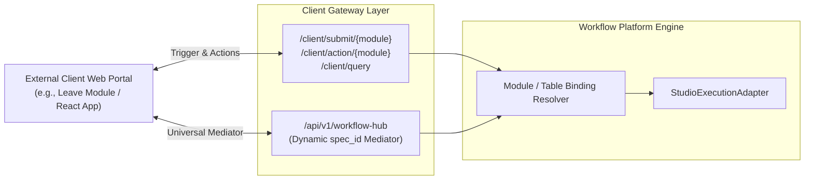

# Client Application Gateway

## 1. Gateway Purpose & Architecture

The **Client Application Gateway** (`/client` and `/api/v1/workflow-hub`) serves as the integration interface between external business portals (e.g. Employee Self-Service, HR Management, Risk Registers, Procurement Microservices) and the workflow execution engine.

External applications do not need knowledge of internal workflow graph structures, BPMN schemas, or database connection pool handles. They interact through clean, standardized REST APIs.



---

## 2. Gateway Endpoints Reference

### A. Record Submission & Workflow Trigger
- **Endpoint**: `POST /client/submit/{module_code}`
- **Purpose**: Creates a business record in the client database and initiates its bound workflow.
- **Request Body**:
  ```json
  {
    "data": {
      "employee_id": 105,
      "leave_type": "ANNUAL",
      "days": 4,
      "reason": "Family vacation"
    },
    "user_id": 105,
    "user_name": "Alice Smith",
    "user_email": "alice@company.com",
    "async_execution": false
  }
  ```
- **Response**:
  ```json
  {
    "data": {
      "record_id": 42,
      "instance_id": 108,
      "status": "WAITING",
      "current_task": "Manager Approval"
    },
    "Error": { "Error": false, "Error_message": "Success", "Error_Code": 200 }
  }
  ```

---

### B. Action Decision Submission
- **Endpoint**: `POST /client/action/{module_code}`
- **Purpose**: Submits an approver's decision (`APPROVE`, `REJECT`) to advance a waiting workflow.
- **Request Body**:
  ```json
  {
    "record_id": 42,
    "action": "APPROVE",
    "user_id": 3,
    "role": "MANAGER",
    "remarks": "Approved. Have a great vacation!",
    "variables": { "leave_balance_verified": true }
  }
  ```

---

### C. Pending Task Inbox Query
- **Endpoint**: `GET /client/tasks/{module_code}?user_id=3&role_id=2`
- **Purpose**: Returns all business records awaiting approval by the specified user or role.
- **Response**: Array of tasks containing `task_id`, `record_id`, `created_on`, and business record attributes.

---

### D. Generic Client Database Query (`POST /client/query`)
Allows client frontends to retrieve or filter records without writing custom backend endpoints.

> [!IMPORTANT]
> **Server-Enforced Scope & Access Control**: Access control must never rely on untrusted client-supplied `table_name` or filters. The gateway restricts execution to an explicit allowlist of authorized client tables and injects a mandatory server-owned row-scope predicate tied directly to `current_user` (e.g., scoping `employee_id = current_user["user_id"]`) to guarantee row-level isolation.

```json
{
  "table_name": "leave_requests",
  "connection_id": 1,
  "operation": "SELECT",
  "columns": ["id", "employee_id", "leave_type", "status", "created_at"],
  "filters": [
    { "field": "status", "operator": "=", "value": "PENDING" }
  ],
  "order_by": "created_at",
  "order_direction": "DESC",
  "limit": 50,
  "offset": 0
}
```

*Server-Side Enforcement Pattern:*
```python
# 1. Restrict to registered/authorized tables only
if table_name not in ALLOWED_TABLES:
    raise HTTPException(status_code=403, detail="Access to table is not permitted")

# 2. Server injects mandatory identity predicate from verified token
filters = list(payload.filters or [])
if not current_user.get("is_admin"):
    filters.append({"field": "employee_id", "operator": "=", "value": current_user["user_id"]})
```

---

## 3. Universal Workflow Hub (`/api/v1/workflow-hub`)

For microservices and mobile applications integrating with multiple diverse workflows, the **Universal Workflow Hub** (`backend/app/workflow/api/workflow_hub_api.py`) provides a single endpoint supporting dynamic operations:

| Operation Key | Description | Required Parameters |
| :--- | :--- | :--- |
| `SUBMIT` | Starts a workflow instance with form data. | `spec_id`, `parameter` dictionary |
| `ACTION` | Submits an approval or rejection. | `spec_id`, `record_id`, `action` |
| `FETCH_RECORDS` | Queries business records for the workflow's table. | `spec_id`, optional filters |
| `GET_TASKS` | Returns pending approval tasks for the workflow. | `spec_id`, `user_id` or `role` |
| `SCHEMA` | Returns input field layout and table definitions. | `spec_id` |
| `HISTORY` | Returns execution history for a record. | `spec_id`, `record_id` |
| `CATALOG` | Returns all active workflows and schemas. | None |

---

## 4. Integration Code Example (Client Web Portal)

Integrating any web application takes three simple JavaScript calls:

```javascript
// 1. Submit Request
const submitRes = await fetch('http://localhost:8000/api/v1/workflow-hub', {
  method: 'POST',
  headers: { 'Content-Type': 'application/json' },
  body: JSON.stringify({
    spec_id: 'leave_approval',
    operation: 'SUBMIT',
    parameter: { employee_id: 12, days: 3, reason: 'Personal' }
  })
});
const { data: submitData } = await submitRes.json();
console.log('Started instance:', submitData.instance_id);

// 2. Fetch User Inbox Tasks
const tasksRes = await fetch('http://localhost:8000/api/v1/workflow-hub?spec_id=leave_approval&operation=GET_TASKS&user_id=3');
const { data: pendingTasks } = await tasksRes.json();

// 3. Approve Task
await fetch('http://localhost:8000/api/v1/workflow-hub', {
  method: 'POST',
  headers: { 'Content-Type': 'application/json' },
  body: JSON.stringify({
    spec_id: 'leave_approval',
    operation: 'ACTION',
    record_id: submitData.record_id,
    action: 'APPROVE',
    remarks: 'Approved by manager'
  })
});
```

---

## 5. Related Documentation Links

- API Specification: [API Reference](../02-backend/api-reference.md)
- Real-time Events: [WebSocket Events](./websocket-events.md)
- Node Inventory: [Activities & Node Inventory](../03-workflow-engine/activities-and-nodes.md)
