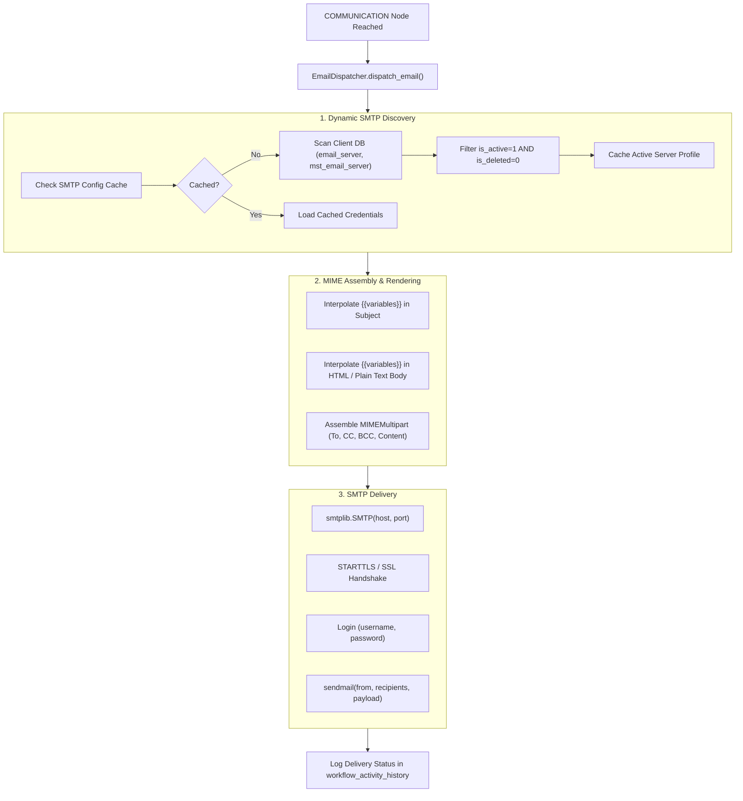

# Email & Notification Services

## 1. Overview & Dynamic Architecture

The **Email & Notification Service** (`backend/app/workflow/services/email_dispatcher.py`) delivers automated emails triggered by `COMMUNICATION` workflow nodes.

Rather than relying on static, hardcoded credentials in backend environment files, the service dynamically queries client database tables (e.g. `email_server`, `mst_email_server`, `smtp_settings`) to discover active SMTP server configurations at runtime.



---

## 2. Dynamic SMTP Configuration Discovery

When an email must be dispatched:
1. `EmailDispatcher.get_smtp_config(conn_id)` obtains a database connection from `DynamicEnginePool`.
2. It queries candidate tables in the client database:
   - `email_server`, `dbo.email_server`, `public.email_server`, `ers.email_server`
   - `mst_email_server`, `dbo.mst_email_server`
   - `smtp_settings`, `email_config`
3. It validates that the record has `is_active = 1` and `is_deleted = 0`.
4. Extracted fields include:
   - `host` / `server_name` / `smtp_host`
   - `port` / `smtp_port` (defaults to 587 for TLS, 465 for SSL, or 25)
   - `username` / `smtp_user` / `auth_user`
   - `password` / `smtp_password`
   - `from_email` / `sender_email` / `default_sender`
   - `use_tls` / `enable_ssl`

---

## 3. Template Rendering & Variable Interpolation

The email dispatcher merges runtime context variables into the template body:

### Variable Chip Syntax:
Any variable available in the workflow execution context can be interpolated using `{{variable_name}}`:
```html
<div style="font-family: Arial, sans-serif; padding: 20px; border: 1px solid #e2e8f0;">
  <h2 style="color: #4f46e5;">Leave Request Update</h2>
  <p>Dear <strong>{{employee_name}}</strong>,</p>
  <p>Your request for <strong>{{days}} day(s)</strong> of <em>{{leave_type}}</em> leave has been <strong>{{status}}</strong> by {{approver_name}}.</p>
  <p><strong>Remarks:</strong> {{remarks}}</p>
  <hr style="border: none; border-top: 1px solid #e2e8f0;" />
  <p style="font-size: 12px; color: #64748b;">Enterprise Workflow Platform Automated Notification</p>
</div>
```

### Recipient Resolution:
- `To`: Supports single email strings, comma-separated lists, JSON arrays, or dynamic context variables (e.g. `{{requester_email}}`).
- `CC`: Carbon copy recipients.
- `BCC`: Blind carbon copy recipients.

---

## 4. SMTP Connection & Delivery Protocol

Implemented via the Python standard library `smtplib`:
1. **Connection**: Establishes socket connection with `timeout = 15`.
2. **TLS / SSL Negotiation**:
   - If port is `465` or `enable_ssl = true`, initiates `smtplib.SMTP_SSL`.
   - If port is `587` or `25`, initiates standard `smtplib.SMTP` and issues `.starttls()`.
3. **Authentication**: Performs authenticated login if credentials exist.
4. **Delivery**: Issues `.sendmail()` with all resolved `To`, `CC`, and `BCC` recipients.
5. **Connection Teardown**: Cleanly calls `.quit()`.

---

## 5. Failure Handling & Audit Logging

- **Transient Network Failures**: Captured in a `try...except` block; does not crash the server process.
- **Trace Commits**: Writes a record to `workflow_activity_history`:
  - `status`: `'COMPLETED'` on delivery success, or `'FAILED'` on connection error.
  - `error_message`: Contains exact SMTP response code (e.g., `535 Authentication failed`, `Connection refused`).
  - `variables`: Stores recipient list and delivery timestamp.

---

## 6. Related Documentation Links

- Node Configuration: [Node Configuration Panels](../04-frontend/node-configuration.md)
- Activities Inventory: [Activities & Node Inventory](../03-workflow-engine/activities-and-nodes.md)
- Client Database Pooling: [Client Database Integration](../05-database/client-database-integration.md)
