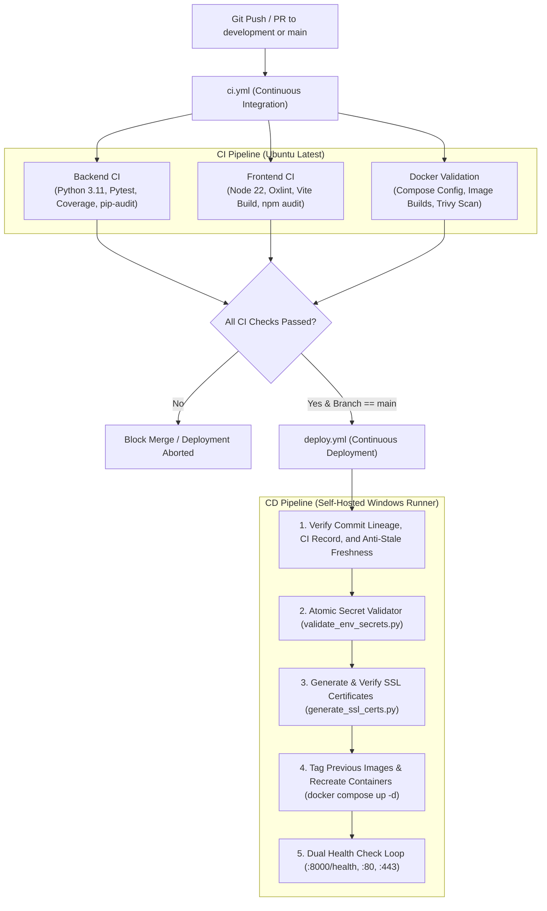

# CI/CD Pipeline

## 1. Overview & Pipeline Strategy

Continuous Integration and Continuous Deployment (CI/CD) in **WorkFlow-Automation** are implemented using GitHub Actions workflows located in `.github/workflows/`:
1. **`ci.yml` (Continuous Integration)**: Triggered on every `push` and `pull_request` to `development` and `main`. Executes automated backend unit tests, code coverage analysis, dependency vulnerability scans, frontend linting, production asset bundling, Docker syntax validation, and container vulnerability scanning via Trivy.
2. **`deploy.yml` (Continuous Deployment)**: Automates production deployments to the on-premise self-hosted Windows runner host. Triggered automatically upon successful completion of CI on the `main` branch, or manually via `workflow_dispatch`.



---

## 2. Continuous Integration (`ci.yml`)

### Job 1: `backend-ci` (Python 3.11)
- **Environment**: Ubuntu latest, Python 3.11.
- **System Dependencies**: Installs `unixodbc-dev`, `freetds-dev`, `libpq-dev`.
- **Security Audit**: Runs `pip-audit` against `backend/requirements.txt` to detect upstream CVEs.
- **Test Suite**:
  ```bash
  python -m pytest tests/ -v --tb=short --cov=app --cov-report=term-missing --cov-report=xml
  ```
  Runs with isolated in-memory/mock databases (`WORKFLOW_DATABASE_URL: sqlite:///main_test.db`).

### Job 2: `frontend-ci` (Node 22)
- **Environment**: Ubuntu latest, Node.js 22.
- **Dependency Audit**: `npm audit --audit-level=critical`.
- **Linter**: Runs `oxlint` (`npm run lint`), validating JavaScript and React syntax.
- **Asset Compilation**: Runs `npm run build` (`vite build`), verifying bundle generation into `dist/`.

### Job 3: `docker-validation`
- **Compose Syntax**: Copies `.env.example` and executes `docker compose config --quiet`.
- **Image Compilation**: Builds `workflow-backend:ci` and `workflow-frontend:ci`.
- **Trivy Vulnerability Scanner**: Executes `aquasecurity/trivy-action@v0.36.0` scanning both container images for `CRITICAL` and `HIGH` CVEs.

---

## 3. Continuous Deployment (`deploy.yml`)

The deployment workflow runs on a self-hosted Windows runner hosting Docker Engine:

### Stage 1: Commit Lineage, CI Status, and Freshness Checks
- **Lineage Verification**: Uses `git merge-base` to guarantee the target commit is an ancestor of the production `main` branch.
- **Anti-Stale Protection**: For automatic triggers (`workflow_run`), ensures no newer commit has reached `main` between CI completion and deployment trigger.
- **CI Status Verification**: For manual triggers (`workflow_dispatch`), queries the GitHub REST API (`https://api.github.com/repos/.../actions/runs`) to verify that the specified commit has a passing CI run on record.

### Stage 2: Atomic Secret Validation (`validate_env_secrets.py`)
- Executes `python backend/validate_env_secrets.py --write`.
- Validates that `WORKFLOW_DATABASE_URL`, `SECRET_KEY`, `FERNET_KEY`, `MAIN_URL`, and `GRAFANA_ADMIN_PASSWORD` exist, meet cryptographic length criteria, and contain no placeholder strings.
- Writes the production `.env` atomically using a temporary file and atomic swap to prevent partial writes.

### Stage 3: SSL Certificate Generation & Verification (`generate_ssl_certs.py`)
- Automatically generates 2048-bit RSA keys and X.509 certificates in `backend/certs/`.
- Verifies expiration and ensures all SAN candidates (`localhost`, LAN IP, `MAIN_URL`) are covered.

### Stage 4: Safety Tagging & Container Deployment
- Tags current running images as `workflow-backend:previous` and `workflow-frontend:previous` for instant rollback.
- Rebuilds and launches containers:
  ```powershell
  docker compose up -d --remove-orphans
  ```

### Stage 5: Multi-Endpoint Health Verification
The pipeline executes a 20-retry loop (4-second sleep, up to 80s) testing all layers:
1. **Container State**: `docker inspect` verifies both `workflow-backend` and `workflow-frontend` are in `running` state.
2. **Backend API HTTP Health**: `GET http://localhost:8000/health` returns `status == "healthy"`.
3. **Frontend HTTP Server**: `GET http://localhost:80/` returns HTTP `200`.
4. **Frontend HTTPS Endpoint**: `GET https://localhost:443/` returns HTTP `200`.

### Diagnostic Failure Logging
If any health check fails:
- Dumps `docker compose ps -a`.
- Captures trailing 60 lines of backend logs (`docker compose logs --tail=60 backend`).
- Captures trailing 60 lines of frontend Nginx logs (`docker compose logs --tail=60 frontend`).

---

## 4. Required GitHub Repository Secrets

For the CD workflow to function, the following secrets must be defined in repository settings:

| Secret Name | Purpose & Format |
| :--- | :--- |
| `WORKFLOW_DATABASE_URL` | Production PostgreSQL connection URI (`postgresql+psycopg2://...`). |
| `SECRET_KEY` | 32+ character random hex key for JWT token signing. |
| `FERNET_KEY` | 32-byte URL-safe base64 string for credential encryption. |
| `MAIN_URL` | Target production URL (e.g. `https://192.168.1.183`). |
| `GRAFANA_ADMIN_PASSWORD`| Secure password for Grafana observability portal. |

---

## 5. Related Documentation Links

- Docker Infrastructure: [Docker Deployment](./docker-deployment.md)
- Security Review: [Security Review](../08-quality-and-maintenance/security-review.md)
- Troubleshooting: [Troubleshooting](./troubleshooting.md)
