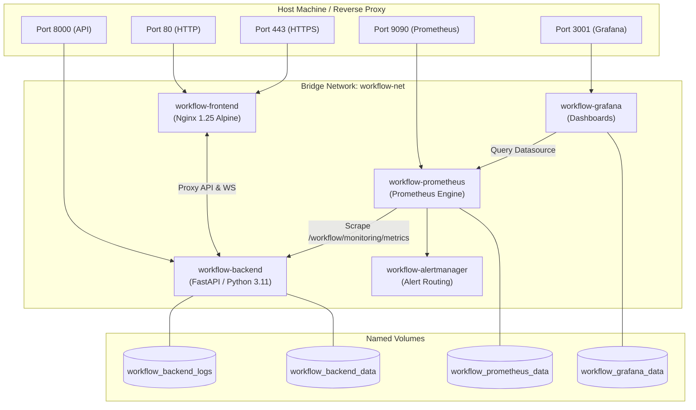

# Docker Deployment

## 1. Overview & Container Architecture

The **WorkFlow-Automation** platform provides a production-ready, containerized deployment topology defined in `docker-compose.yml`.

The stack orchestrates five isolated containers connected via a private bridge network (`workflow-net`):
1. **`workflow-backend`**: FastAPI application server running under Python 3.11-slim.
2. **`workflow-frontend`**: Production Nginx container hosting built React 19 static assets and terminating SSL/TLS.
3. **`workflow-prometheus`**: Metrics scraper and monitoring engine.
4. **`workflow-alertmanager`**: Alert management and notification router.
5. **`workflow-grafana`**: Observability dashboards and visual telemetry.



---

## 2. Container Service Inventory

### 1. `backend` (`workflow-backend`)
- **Base Image**: `python:3.11-slim` (defined in `backend/Dockerfile`).
- **Dependencies Installed**: `build-essential`, `libpq-dev`, `unixodbc-dev`, `freetds-dev`, `tdsodbc`, `curl`.
- **Exposed Port**: `8000` (mapped to host `8000:8000`).
- **Health Check**: `curl -f http://localhost:8000/health || exit 1` (15s interval, 5s timeout, 3 retries).
- **Volumes**:
  - `workflow_backend_logs` &rarr; `/app/logs`
  - `workflow_backend_data` &rarr; `/app/data`

### 2. `frontend` (`workflow-frontend`)
- **Base Image**: Multi-stage build (`node:22-alpine` builder &rarr; `nginx:alpine` runner, defined in `frontend/Dockerfile`).
- **Exposed Ports**: `80` (HTTP), `443` (HTTPS), `3000` (mapped to port 80).
- **SSL Certificate Mounting**: Mounts `./backend/certs` as `/etc/nginx/ssl:ro`.
- **Health Check**: `wget -q --spider http://localhost:80/ || exit 1` (15s interval, 5s timeout, 3 retries).
- **Service Dependency**: `depends_on: backend (condition: service_healthy)`.

### 3. `prometheus` (`workflow-prometheus`)
- **Image**: `prom/prometheus:latest`.
- **Port**: `9090:9090`.
- **Configuration**: Mounted from `./monitoring/prometheus` into `/etc/prometheus`.

### 4. `alertmanager` (`workflow-alertmanager`)
- **Image**: `prom/alertmanager:latest`.
- **Port**: `9093:9093`.
- **Configuration**: Mounted from `./monitoring/alertmanager` into `/etc/alertmanager`.

### 5. `grafana` (`workflow-grafana`)
- **Image**: `grafana/grafana:latest`.
- **Port**: `3001:3000`.
- **Environment**: Configured via `GF_SECURITY_ADMIN_USER` and `GF_SECURITY_ADMIN_PASSWORD`.
- **Provisioning**: Auto-provisions Prometheus datasource and dashboards from `./monitoring/grafana/provisioning`.

---

## 3. Deployment Procedure

### Prerequisites:
1. Docker Desktop or Docker Engine 24+ installed and running.
2. Production environment file created (`.env` in root directory based on `backend/.env.example`).
3. SSL certificates generated in `backend/certs/` (`python backend/generate_ssl_certs.py`).

### Option A: One-Click Windows Deployment Script
Execute `docker_deploy.bat`:
```powershell
.\docker_deploy.bat
```
The script:
1. Verifies Docker Engine status.
2. Generates SSL certificates if missing.
3. Tags previous running images as `workflow-backend:previous` and `workflow-frontend:previous` for rollback safety.
4. Builds and starts the container stack (`docker compose up -d --build --remove-orphans`).

---

### Option B: Manual Cross-Platform Deployment
```bash
# 1. Validate environment configuration
cp backend/.env.example .env
# Edit .env with your production values

# 2. Generate SSL certificates
python backend/generate_ssl_certs.py

# 3. Build and launch stack
docker compose up -d --build --remove-orphans

# 4. Verify running services and health status
docker compose ps
```

---

## 4. Rollback Procedure

To roll back or cleanly stop a deployment:

### Windows Rollback Script:
```powershell
.\docker_rollback.bat
```

### Manual Rollback:
```bash
# 1. Stop active containers
docker compose down

# 2. (Optional) Restore previous image tags
docker tag workflow-backend:previous workflow-backend:latest
docker tag workflow-frontend:previous workflow-frontend:latest
docker compose up -d
```

---

## 5. Related Documentation Links

- CI/CD Deployment Workflow: [CI/CD Pipeline](./ci-cd-pipeline.md)
- Monitoring & Telemetry: [Monitoring & Alerting](./monitoring-and-alerting.md)
- Troubleshooting Guide: [Troubleshooting](./troubleshooting.md)
