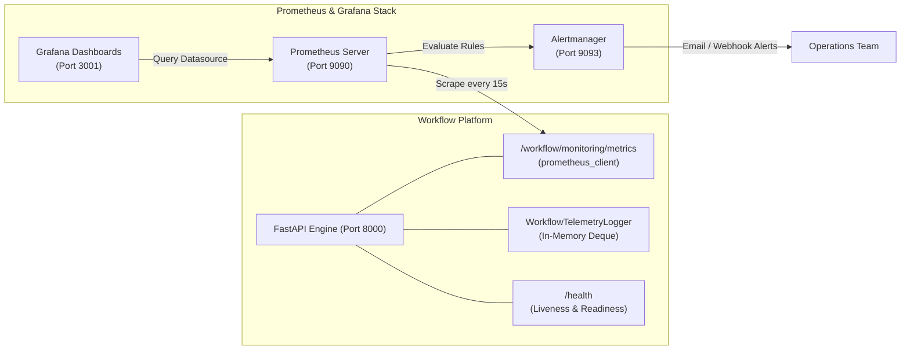

# Monitoring & Alerting

## 1. Monitoring Strategy & Observability Stack

The **WorkFlow-Automation** platform incorporates a multi-layered observability strategy combining:
1. **Application-Level Telemetry**: In-memory ring buffers and real-time WebSocket event streaming.
2. **Prometheus Metrics Engine**: Automated time-series scraping of execution latency, queue depth, and failure counters.
3. **Grafana Dashboards**: Visual dashboards pre-provisioned via Docker Compose.
4. **Alertmanager**: Rule-based notification routing for high error rates or container health degradations.



---

## 2. Application Health & Metrics Endpoints

### 1. Service Liveness & Readiness (`GET /health`)
- Evaluates basic application server responsiveness and returns service metadata.
- Used by Docker health checks (`curl -f http://localhost:8000/health || exit 1`) and CI/CD deployment scripts.

### 2. Prometheus Metrics (`GET /workflow/monitoring/metrics`)
Exported via `prometheus_client` for scraping by Prometheus:
- HTTP request counters partitioned by method, endpoint, and status code.
- Workflow execution duration histograms.
- Active worker pool threads and task queue depth.
- Total completed, waiting, and failed workflow instances.

### 3. Worker Pool Observability (`GET /workflow/executor/status`)
Provides real-time executor thread metrics:
```json
{
  "status": "HEALTHY",
  "max_workers": 8,
  "active_tasks": 2,
  "total_submitted": 340,
  "total_completed": 335,
  "total_failed": 3,
  "queue_depth": 0,
  "is_paused": false
}
```

### 4. Telemetry Ring Buffer (`GET /workflow/monitoring/telemetry`)
- Maintained by `WorkflowTelemetryLogger` in `backend/app/core/logger.py`.
- Stores the last 1,000 granular events (query latencies, branch decisions, email dispatches).
- Accessed via the visual monitoring dashboard for real-time trace inspection.

---

## 3. Prometheus & Alert Rules Configuration

Located in `monitoring/prometheus/`:

### Scraper Configuration (`prometheus.yml`):
```yaml
global:
  scrape_interval: 15s
  evaluation_interval: 15s

rule_files:
  - "alert_rules.yml"

scrape_configs:
  - job_name: "workflow-backend"
    metrics_path: "/workflow/monitoring/metrics"
    static_configs:
      - targets: ["workflow-backend:8000"]
```

### Pre-Configured Alert Rules (`alert_rules.yml`):
- **`WorkflowBackendDown`**: Alerts if `workflow-backend` is unreachable for > 1 minute.
- **`HighWorkflowFailureRate`**: Alerts if failed workflow executions exceed 5% over a 5-minute window.
- **`ExecutorQueueBacklog`**: Alerts if `queue_depth` exceeds 50 pending jobs for > 3 minutes.

---

## 4. Grafana Dashboards

Grafana runs on port `3001` (mapped to `3000` in `docker-compose.yml`):
- **Default Credentials**: Configured via `GRAFANA_ADMIN_USER` (default `admin`) and `GRAFANA_ADMIN_PASSWORD` in `.env`.
- **Datasource Provisioning**: Auto-provisions the Prometheus connection (`http://prometheus:9090`) on startup from `monitoring/grafana/provisioning/datasources/`.
- **Pre-Configured Visuals**:
  - Hourly workflow execution throughput.
  - Mean execution latency per workflow specification.
  - Human task backlog by department and role.
  - Active database connection pool utilization.

---

## 5. Related Documentation Links

- Docker Deployment: [Docker Deployment](./docker-deployment.md)
- In-App Monitoring UI: [Execution & Monitoring UI](../04-frontend/execution-and-monitoring-ui.md)
- Troubleshooting: [Troubleshooting](./troubleshooting.md)
