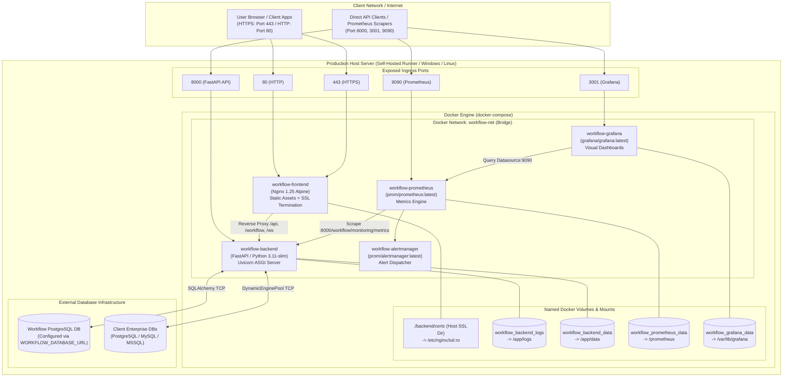

# Deployment Architecture Diagram

This document illustrates the physical and container deployment topology supported by the repository's configuration artifacts (`docker-compose.yml`, `backend/Dockerfile`, `frontend/Dockerfile`, and `deploy.yml`).

---

## 1. Production Container Topology

---

## 2. Port Mapping & Ingress Summary

| Container Name | Internal Port | Host Port | Protocol | Purpose |
| :--- | :--- | :--- | :--- | :--- |
| **`workflow-frontend`** | `80` | `80`, `3000` | HTTP | Nginx HTTP web server (redirects to HTTPS or serves SPA). |
| **`workflow-frontend`** | `443` | `443` | HTTPS | Nginx SSL/TLS termination with mounted certificates. |
| **`workflow-backend`** | `8000` | `8000` | HTTP / HTTPS | FastAPI Uvicorn application server and WebSocket gateway. |
| **`workflow-prometheus`**| `9090` | `9090` | HTTP | Prometheus time-series metrics interface. |
| **`workflow-alertmanager`**| `9093` | `9093` | HTTP | Alertmanager rule evaluation dashboard. |
| **`workflow-grafana`** | `3000` | `3001` | HTTP | Grafana analytics portal. |

---

## 3. Related Documentation Links

- Docker Deployment Guide: [Docker Deployment](../07-operations/docker-deployment.md)
- CI/CD Deployment: [CI/CD Pipeline](../07-operations/ci-cd-pipeline.md)
- System Context: [System Context Diagram](./system-context.md)
