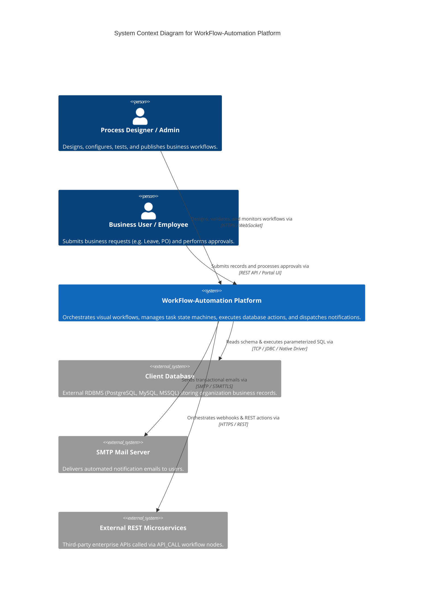
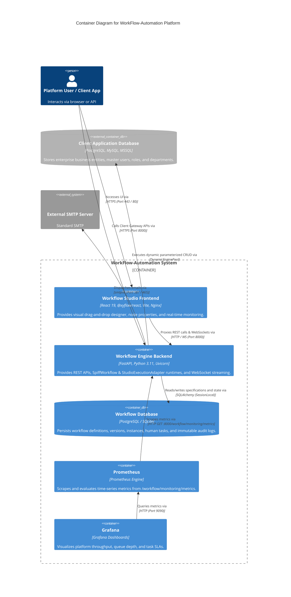

# System Context & Container Diagram

This document presents the high-level system context and container boundaries of the **WorkFlow-Automation** platform using Mermaid C4-style diagramming.

---

## 1. System Context Diagram (Level 1)

---

## 2. Container Diagram (Level 2)

---

## 3. Related Documentation Links

- High-Level Architecture: [System Architecture](../01-overview/system-architecture.md)
- Execution Sequence: [Workflow Execution Sequence](./workflow-execution-sequence.md)
- Deployment Topology: [Deployment Architecture](./deployment-architecture.md)
