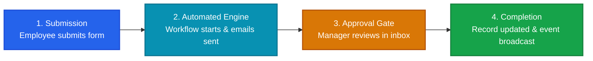
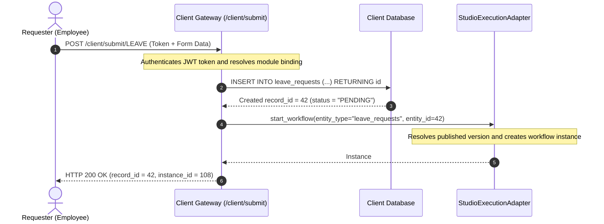
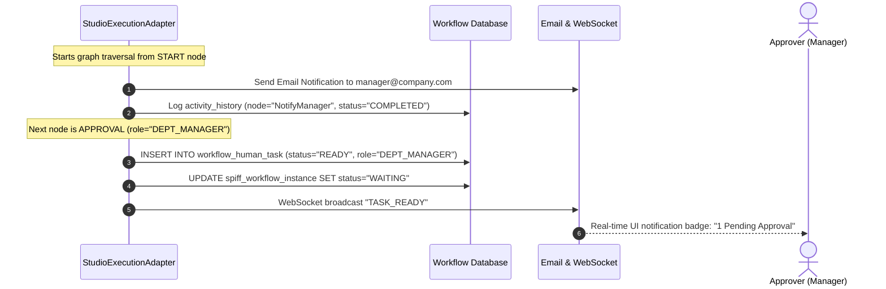
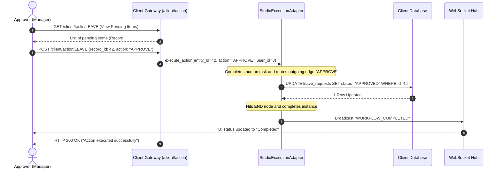

# Workflow Execution Sequence & Lifecycle Guide

This document explains the end-to-end execution path of the **WorkFlow-Automation** platform in a clear, accessible visual format. 

---

## 1. High-Level Executive Journey

The workflow lifecycle operates in four simple stages:

---

## 2. End-to-End Execution Sequence Diagrams

To keep diagrams clean and readable across both desktop and mobile screens, the complete flow is broken into three focused, sequential phases.

### Phase 1: Request Ingestion & Workflow Initiation

When an employee submits a new business request (e.g., Leave Application, Purchase Order):

---

### Phase 2: Automated Steps & Human Approval Gate

The engine traverses automated tasks, sends notifications, and halts at the approval gate:

---

### Phase 3: Manager Decision, State Synchronization & Completion

The manager reviews the item in their inbox and submits a decision:

---

## 3. Runtime State Progression Matrix

This table summarizes how state changes across databases and components at each milestone:

| Milestone / Event | Client DB Record Status | Workflow Instance Status | Human Task Status | Active Notification |
| :--- | :--- | :--- | :--- | :--- |
| **1. Form Submitted** | `PENDING` | `Running` | *(None)* | `WORKFLOW_STARTED` |
| **2. Email Dispatched** | `PENDING` | `Running` | *(None)* | Email sent to manager |
| **3. Approval Gate Hit** | `PENDING` | `WAITING` | `READY` (Role: Manager) | `TASK_READY` (WebSocket) |
| **4. Decision Submitted**| `PENDING` &rarr; `APPROVED` | `Running` &rarr; `Completed` | `COMPLETED` | `TASK_COMPLETED` (WebSocket) |
| **5. Process Terminal** | `APPROVED` | `Completed` | `COMPLETED` | `WORKFLOW_COMPLETED` |

---

## 4. Key Component Directory

| Component | Responsibility in Sequence |
| :--- | :--- |
| **Client Gateway** (`client_gateway.py`) | Authenticates JWT tokens, validates inputs, and coordinates client-side CRUD with workflow triggers. |
| **Dynamic Engine Pool** (`database.py`) | Dynamically resolves and manages database connection pools for multiple client databases. |
| **Studio Execution Adapter** (`adapter.py`) | Executes published workflow graphs node by node, evaluates conditions, and manages instance state. |
| **Condition Evaluator** (`actions.py`) | Evaluates edge rules and decisions (`APPROVE`, `REJECT`) to determine the next active branch. |
| **WebSocket Hub** (`websocket.py`) | Pushes real-time execution updates to connected browser clients without polling. |

---

## 5. Related Technical Documentation

- [Engine Architecture](../03-workflow-engine/engine-architecture.md) — Node evaluation loop and engine internals.
- [Human Tasks & Approvals](../03-workflow-engine/human-tasks-and-approvals.md) — Human task data models, inbox queries, and role authorization.
- [Client Application Gateway](../06-integrations/client-application-gateway.md) — API reference for client submissions and action triggers.
- [WebSocket Real-Time Events](../06-integrations/websocket-events.md) — WebSocket lifecycle and JSON payload taxonomy.
