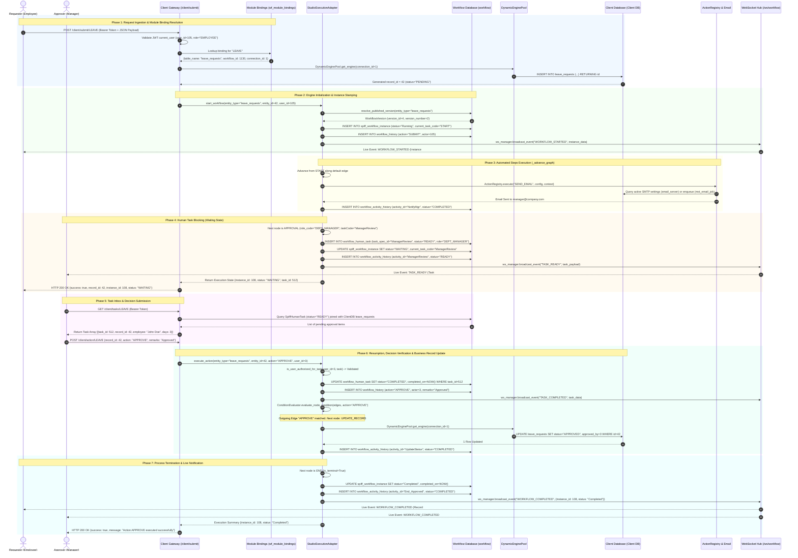
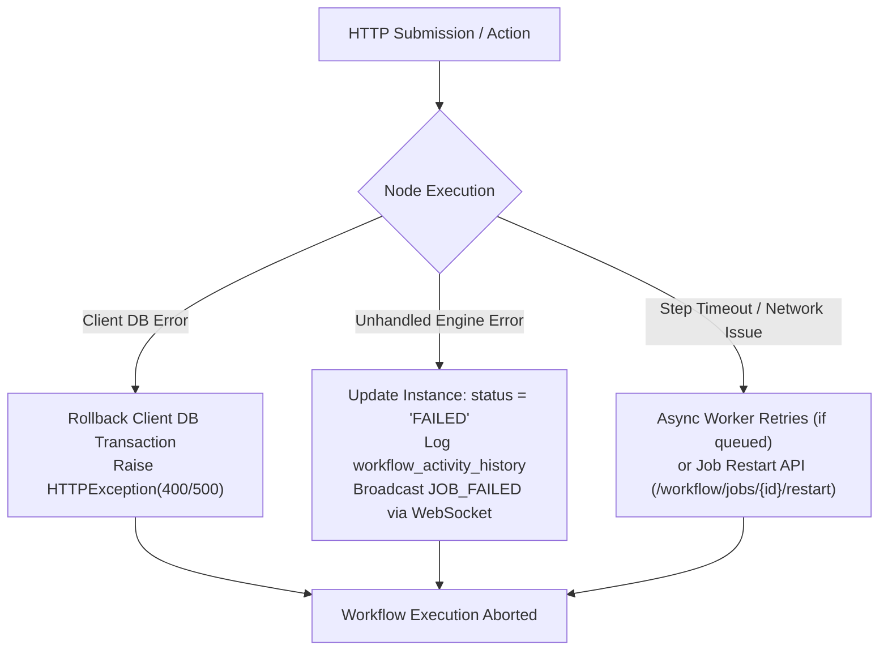

# Workflow Execution Sequence Diagram

This document illustrates the complete end-to-end request and execution path through the **WorkFlow-Automation** engine. It visualizes the entire lifecycle: initial client form submission, dynamic module binding lookup, automated node execution, human approval gate pausing, task inbox inspection, decision submission, conditional routing, and final terminal state synchronization.

---

## 1. System Participants

| Participant Key | Component | Responsibility |
| :--- | :--- | :--- |
| **`Requester`** | Client Application / Portal | Submits new business records (e.g., Leave Application, Purchase Order). |
| **`Approver`** | Approval Inbox / Client UI | Reviews pending human tasks and submits decisions (`APPROVE` / `REJECT`). |
| **`Gateway`** | `ClientGateway` / `BindingsAPI` | Authenticates JWT tokens, validates inputs, and coordinates domain actions. |
| **`Bindings`** | `wf_module_bindings` | Resolves module codes to client tables, workflow definitions, and connection IDs. |
| **`Adapter`** | `StudioExecutionAdapter` | Core runtime engine that traverses graph nodes, evaluates conditions, and drives state machines. |
| **`WfDB`** | Workflow Database | Stores workflow graphs, versions, instances, activity traces, and audit histories. |
| **`Pool`** | `DynamicEnginePool` | Thread-safe connection pool manager providing live engines to external client databases. |
| **`ClientDB`** | Client Database (PostgreSQL/MySQL/MSSQL) | External client database holding business entity records, users, and audit logs. |
| **`ActionReg`** | `ActionRegistry` & `EmailDispatcher` | Executes automated task handlers (`READ_RECORD`, `CREATE_RECORD`, `UPDATE_RECORD`, `SEND_EMAIL`). |
| **`WS`** | `WorkflowConnectionManager` | WebSocket broadcast hub streaming real-time status updates to connected clients. |

---

## 2. Complete Workflow Execution Sequence

---

## 3. Phase-by-Phase Technical Walkthrough

### Phase 1: Request Ingestion & Module Binding Resolution
1. **Client Submission**: The employee submits a business form via the client portal targeting `POST /client/submit/{module_code}`.
2. **Identity Verification**: The gateway checks the Bearer JWT and extracts `user_id` and assigned roles.
3. **Dynamic Resolution**: The gateway reads `wf_module_bindings` to map `module_code` (`LEAVE`) to:
   - Target database table (`leave_requests`).
   - Workflow definition identifier (`workflow_id = 1130`).
   - Client database connection identifier (`connection_id = 1`).
4. **Initial Client Write**: The client record is inserted with initial status `PENDING` using parameterized SQL via `DynamicEnginePool`.

### Phase 2: Engine Initialization & Instance Stamping
1. **Version Resolution**: `StudioExecutionAdapter.resolve_published_version()` queries `wf_version` to locate the latest published version of the workflow graph.
2. **Instance Creation**: An execution instance record is created in `spiff_workflow_instance`:
   - `status = "Running"`
   - `current_task_code = "START"`
   - `bpmn_definition_id` stamped with `workflow_version_id`
   - `serialized_state` initialized with variables (`entity_id`, `entity_type`, `user_id`).
3. **Audit Stamping**: A submission transition is logged in `workflow_history`.
4. **Event Broadcast**: `ws_manager.broadcast_event("WORKFLOW_STARTED", ...)` pushes a real-time event to all connected dashboard websockets.

### Phase 3: Automated Node Traversal (`_advance_graph`)
1. **Automated Loop**: The execution adapter enters `_advance_graph()` and loops through automated nodes up to a safety threshold of 50 steps.
2. **Action Execution**: When encountering automated nodes (`ACTION`, `RECORD`, `EMAIL`):
   - The engine delegates execution to `ActionRegistry.execute()`.
   - Dynamic parameters (e.g., `{{employee_name}}`, `{{days}}`) are resolved from the runtime context.
   - For email notifications, messages are dispatched via SMTP or enqueued into the client database table `mst_email_job`.
3. **Trace Recording**: Every completed step writes an execution record into `workflow_activity_history`.

### Phase 4: Human Approval Gate & Yield
1. **Approval Detection**: When the engine encounters a node of type `APPROVAL` or `USER_TASK`:
   - Automated traversal halts.
   - A new task record is inserted into `workflow_human_task` with status `READY` and assigned `role_code` (e.g., `DEPT_MANAGER`).
   - The workflow instance is updated to `status = "WAITING"` and stamped with `current_task_code = "ManagerReview"`.
2. **Event Broadcast**: The engine emits `TASK_READY` over `/ws/workflow` so managerial dashboards immediately update their pending badges.
3. **HTTP Return**: The gateway returns HTTP 200 with `{record_id: 42, instance_id: 108, status: "WAITING"}`.

### Phase 5: Inbox Review & Decision Submission
1. **Inbox Polling / Inspection**: Managers open the Studio Approval Inbox or Client Portal (`GET /client/tasks/LEAVE`).
2. **Task Query**: The system queries active `SpiffHumanTask` records filtered by the approver's assigned roles and users.
3. **Decision Action**: The manager reviews the record attributes and submits a decision via `POST /client/action/LEAVE` with `action: "APPROVE"` and optional comments.

### Phase 6: Graph Resumption, Edge Routing & Record Finalization
1. **Authorization Guard**: `StudioExecutionAdapter.execute_action()` verifies that the acting user has permission to approve this specific task.
2. **Task Completion**: `SpiffHumanTask` is marked `status = "COMPLETED"`, stamping `assignee_id` and `completed_on = NOW()`.
3. **History Logging**: The approval transition is recorded in `workflow_history`.
4. **Conditional Edge Traversal**:
   - `ConditionEvaluator` evaluates outgoing connections from the approval node against the decision (`APPROVE`).
   - The matching branch directs execution to an automated `UPDATE_RECORD` node.
5. **Client Record Update**: `DynamicEnginePool` executes a parameterized `UPDATE` query against the client database, advancing the domain record from `PENDING` to `APPROVED`.

### Phase 7: Process Termination & Live Notification
1. **End Node Reached**: The graph enters an `END` node.
2. **Instance Finalization**: `spiff_workflow_instance` is updated to `status = "Completed"` with `completed_on = NOW()`.
3. **Trace Logged**: Final activity record written to `workflow_activity_history`.
4. **Broadcast Notification**: `ws_manager.broadcast_event("WORKFLOW_COMPLETED", ...)` alerts both requester and manager dashboards simultaneously.
5. **Client Response**: The gateway returns HTTP 200 confirming successful workflow completion.

---

## 4. Failure Boundaries & Error Handling

---

## 5. Related Documentation Links

- Engine Architecture: [Engine Architecture](../03-workflow-engine/engine-architecture.md)
- Runtime Execution: [Runtime Execution](../03-workflow-engine/runtime-execution.md)
- Human Task Details: [Human Tasks & Approvals](../03-workflow-engine/human-tasks-and-approvals.md)
- WebSocket Events: [WebSocket Events](../06-integrations/websocket-events.md)
- Client Gateway: [Client Application Gateway](../06-integrations/client-application-gateway.md)

