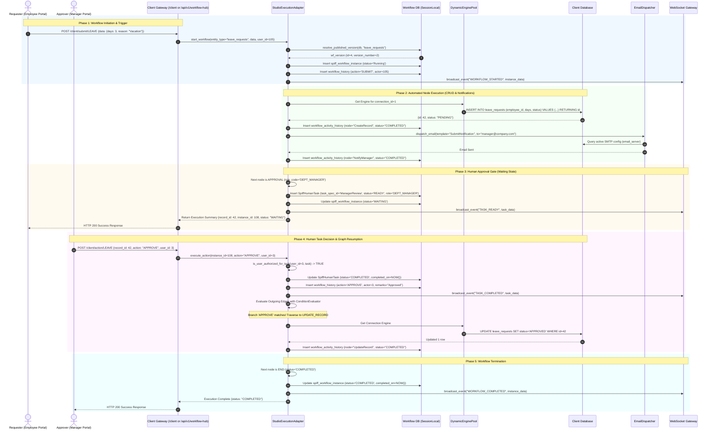

# Workflow Execution Sequence Diagram

This document illustrates the end-to-end request and execution path through the **WorkFlow-Automation** engine, covering initial workflow triggering, automated node execution, human approval gate pausing, decision submission, and final process termination.

---

## 1. Complete Workflow Execution Sequence

---

## 2. Related Documentation Links

- Engine Architecture: [Engine Architecture](../03-workflow-engine/engine-architecture.md)
- Runtime Execution: [Runtime Execution](../03-workflow-engine/runtime-execution.md)
- Human Task Details: [Human Tasks & Approvals](../03-workflow-engine/human-tasks-and-approvals.md)
